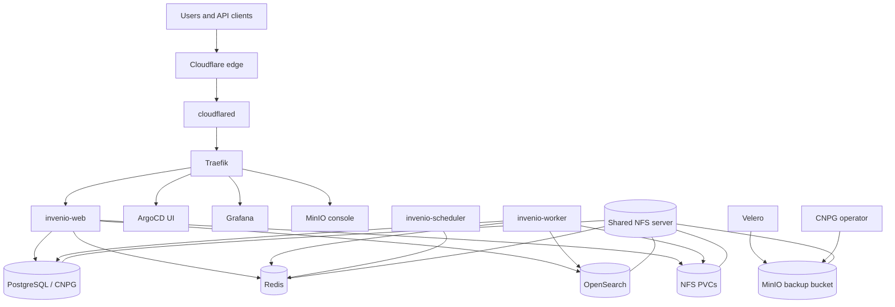
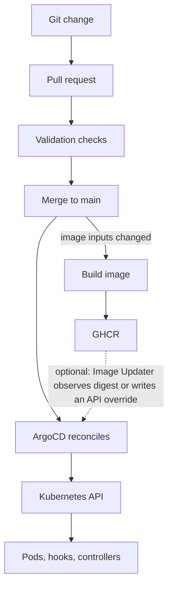

# InvenioRDM GitOps Infrastructure

[](https://github.com/vityasyyy/invenio-rdm-gitops/actions/workflows/validate-infra.yaml)
[](LICENSE)

GitOps configuration for the UGM InvenioRDM research data repository on a
Rancher-managed RKE2 cluster. ArgoCD reconciles the cluster from this repository;
GitHub Actions validates the manifests and builds the custom application image.
The public path is Cloudflare Tunnel, so the cluster needs no inbound firewall
ports.

> New to the system? Read [Understanding this InvenioRDM GitOps
> system](docs/architecture-guide.md) for the request path, ownership boundaries,
> storage, recovery limits, and experiment design.

## Architecture



The two Invenio hostnames terminate at the same `invenio-web` Service; there is
no separate API deployment behind `api-invenio.vityasy.me`. Uploaded file bytes
live on NFS-backed PVCs, while MinIO is the backup object store. All of those
services share one NFS server, so replicas and backups on that server do not
create an independent failure domain.

### Public hostnames and shared edge

| Hostname | Route | Notes |
|---|---|---|
| `invenio.vityasy.me` | Traefik → `invenio-web:8000` → web container `:5000` | UI and REST routes |
| `api-invenio.vityasy.me` | Traefik → the same `invenio-web:8000` | Same application and image |
| `argocd.vityasy.me` | Traefik → ArgoCD server | Control plane UI/API |
| `grafana.vityasy.me` | Traefik → Grafana | Metrics and logs |
| `minio-console.vityasy.me` | Traefik → MinIO console | Backup store administration |

All hostnames share the `vityasy.me` DNS zone and one Cloudflare Tunnel. A DNS,
Cloudflare, or tunnel failure can affect every hostname even while the Kubernetes
workloads are healthy; a healthy Pod is not proof that the public path works.

## Repository map

```text
argocd/
  root.yaml                 # App-of-apps root Application
  apps/                     # 17 child Application definitions
k8s/
  apps/invenio/             # Kustomization + resources/ (web, workers, setup, PVCs)
  dependencies/             # PostgreSQL (CNPG), Redis, OpenSearch
  infra/                    # ArgoCD, Image Updater, security, monitoring, Loki,
                            # Alloy, MinIO, Velero, Sealed Secrets, Traefik
external-lb/
  scripts/                  # Tunnel bootstrap helper
  terraform/                # Cloudflare tunnel/DNS source
docker/ugm/                 # Application image: Dockerfile, invenio.cfg, uWSGI
site/ templates/ static/ assets/ translations/ app_data/  # Image build inputs
scripts/                    # Bootstrap, verification, CI checks, tests
docs/                       # Architecture guide, dated assessments, plans
.github/workflows/          # Validation, image build, deployment verification
.opencode/                  # Agent conventions and workflow skills
```

The canonical [repository map](docs/repository-map.md) lists component entrypoints,
renderers and consumers. AppProject RBAC lives in `k8s/infra/argocd/resources/`;
cloudflared runtime lives in `k8s/infra/cloudflared/`, separately from Terraform.
See [operations](docs/operations.md) for validation and recovery checks.

### Source, generated, and legacy material

| Class | Paths | How to treat it |
|---|---|---|
| **Source of truth** | `argocd/`, `k8s/`, `external-lb/`, `docker/ugm/`, `app_data/`, `assets/`, `static/`, `templates/`, `translations/`, `scripts/`, `.github/workflows/` | Hand-edited, reviewed, and committed. Changes reach the cluster through ArgoCD or an image build. |
| **Generated or runtime-only** | `rendered/` (gitignored CI output), Kubernetes Secrets decrypted from SealedSecrets, Velero `Backup`/`Restore` objects, CNPG `Backup` objects and PVCs, MinIO objects, application data, and an Image Updater override written through the ArgoCD API | Not committed. Do not edit it as if it were Git desired state; verify live ownership before changing it. |
| **Legacy / historical** | `docs/cluster-assessment-*.md`, `docs/plans/completed/`, `site/.gitkeep` | Dated evidence or placeholders, not current deployment instructions. MinIO is no longer the primary application-file store. |

## Delivery and reconciliation



A manifest-only change does not rebuild the image. Publishing an image does not
deploy it by itself: the cluster changes only when the pinned desired digest
changes or Image Updater writes an Application override through the ArgoCD API.
ArgoCD compares and applies resources; Kubernetes controllers perform the rollout
and hooks run around the sync operation.

**CI checks** on pull requests to `main`:

| Check | What it validates |
|---|---|
| Validate YAML Syntax | yamllint plus Velero ownership and Python tests |
| Render & Validate Manifests | kustomize/Helm render, advisory kubeconform, selectors, SealedSecret format |
| Validate ArgoCD Applications | kube-linter, source paths, AppProject repository allowlists |
| Verify Sync Wave Ordering | Wave annotations and project/wave sanity |
| Scan for Secrets | gitleaks |
| Validate Monitoring Rules & Dashboards | promtool, amtool, alert/dashboard contracts |

**Advisory check:** the kubeconform step is invoked with `|| true`; schema
findings do not fail the job. Render, selector, SealedSecret, ArgoCD path/RBAC,
sync-wave, gitleaks, and monitoring checks are enforced.

**Deploy verification** on push to `main` derives the expected Application
inventory from `argocd/apps/` and `argocd/root.yaml`, then requires every tracked
Application to report `Synced`, `Healthy`, no running or failed operation, and
the expected revision for each source: the triggering commit for repository
sources and the declared chart version for Helm charts. Hook phases come from
`status.operationState.syncResult`, and hook resource health comes from the
resource tree. It takes three consecutive clean samples 30 seconds apart within a
15-minute deadline, writes a per-Application table to the GitHub summary, and
then smokes `https://invenio.vityasy.me/ping`.

A terminal operation whose recorded target differs from the expected revision is
reported as historical evidence, not as a new deployment failure; an `Error` or
`Failed` operation with no provable target fails closed. The triggering revision
is an exact match, not a freshness check. If a newer push lands while the run is
waiting, the run reports a revision mismatch and is treated as superseded; it
never passes on an older green state. Changes to this workflow or its verifier
also trigger the check so verifier-only merges are exercised.

Authenticated API reads use the runner's native curl transport with certificate
verification, redirects disabled and bounded deadlines. The bearer token is
passed through stdin configuration, not command-line arguments. This retains the
existing automated access path without changing Cloudflare or ArgoCD policies.

### What ArgoCD owns — and what it does not

| Thing | Source of truth | Runtime owner | Consequence |
|---|---|---|---|
| Manifests, Applications, AppProjects | Git | ArgoCD | A manual managed-field edit is drift and may be reverted by self-heal. |
| Web/worker replica count | HPA bounds in Git | HPA | ArgoCD ignores `/spec/replicas` for both Deployments; a manual replica edit is not the desired-state mechanism. |
| Application image digest | Kustomize pin in Git | Kubernetes pulls the pinned digest | Image Updater can write an override through the ArgoCD API, not Git. Freeze it or pin digests for reproducible experiments. |
| Velero backup schedule | Git `Schedule` | Velero creates `Backup`/`Restore` objects | Generated backup objects are excluded from ArgoCD pruning; backup data lives in MinIO. |
| PostgreSQL backups | Git `Cluster`/`ScheduledBackup` | CNPG operator creates native `Backup` objects and WAL archives | Native DB recovery is separate from Velero filesystem recovery. |
| SealedSecret ciphertext | Git | Sealed Secrets controller | The controller decrypts to a Kubernetes Secret; the private key is outside Git. |
| Research records, files, search documents | Invenio/PostgreSQL/NFS | Invenio and its workers | ArgoCD does not reconcile application data or search documents. |

### HPA and scheduler ownership

- `invenio-web-hpa`: 2–4 replicas, CPU target 70% and memory target 80% of requests.
- `invenio-worker-hpa`: 1–4 replicas, same utilization targets; each worker runs
  Celery concurrency 2.
- `invenio-scheduler`: one replica with `Recreate`. This prevents overlap during a
  normal Deployment revision rollout; it is not a distributed lock or an
  exactly-once task guarantee. The liveness probe checks process presence, not
  scheduling progress.
- PDBs constrain applicable voluntary evictions only. They do not guarantee
  availability during node loss, direct Pod deletion, or a shared dependency failure.

### Setup verification and initialization are separate

`invenio-setup` runs after the sync, not before new web/worker Pods start. It is
read-only: it verifies Alembic heads, the default file location, search index
aliases, declared queues, and the admin superuser permission. It does not migrate,
import fixtures, declare queues, or rebuild indexes, and it fails closed when a
postcondition is missing. A green sync therefore proves those checks passed, not
that the application is functionally correct.

Initialization is a manual, separately approved Job at
`k8s/apps/invenio/initialization/invenio-initialize-job.yaml`. It is not referenced
by the Application Kustomization, so it cannot run during an ordinary sync or a
measured repair. Do not rerun it to make the verification hook green; inspect which
postcondition is missing. Reverting an image does not reverse a database migration.

## Storage, backup, and recovery

`invenio-data` and `invenio-archive` are `ReadWriteMany` PVCs on the `btd-nfs`
StorageClass, which points at one shared NFS server and uses `Retain`. PostgreSQL,
Redis, OpenSearch, MinIO, Loki, Prometheus, Grafana, and Alertmanager also use
`btd-nfs`. The requested PVC sizes are scheduling/claim requests, not enforced
per-directory quotas, and they do not isolate services from NFS-server loss.

### Backup & Restore

The backup design has three separate pieces:

1. Velero backs up selected Kubernetes resources and opt-in Pod volumes to MinIO.
2. CloudNativePG writes PostgreSQL native backups and WAL to MinIO.
3. Invenio stores uploaded file bytes on the NFS PVCs; these are not in MinIO.

Read-only checks:

```bash
kubectl -n velero get backupstoragelocation default
kubectl -n velero get schedules
kubectl -n velero get backups -o wide
kubectl -n database get clusters.postgresql.cnpg.io postgres
kubectl -n database get backups.postgresql.cnpg.io
```

Before creating or restoring anything, get approval. A restore is a mutation and
can overwrite production data. Use an isolated namespace, never restore into
`invenio`, preserve `Retain` PVs, and verify the seeded record, file checksum,
database state, permissions, and search/index behavior. Do not delete backups or
PVs to make an alert quiet.

| Recovery claim | What the evidence supports |
|---|---|
| Kubernetes resources and selected files via Velero | A weekly schedule exists. The latest actual scheduled runs observed on 18 and 25 October were `PartiallyFailed`; the 25 October run canceled two `invenio-archive` volume backups on worker-01 while the same shared PVC completed on worker-02. The exact kubelet/container reason is not yet established. Manual production and canary completions do not prove scheduled coverage. |
| PostgreSQL native recovery | CNPG backups/WAL go to MinIO. Recovery of existing data into an isolated CNPG cluster was verified by schema, row-count, and vocabulary-digest comparison. No seeded application record/file consistency proof exists. |
| Uploaded-file recovery | A 35,840-byte canary file restored with the same SHA-256 into an isolated namespace. The owner approved a private draft with a deterministic 64 KiB file, save-only with no publication or DOI; the upload/save ID is still awaited and no seeded restore has completed. Production file recovery remains unproven. |
| Application-consistent recovery | Not proven. No seeded Invenio record plus file, permissions, and index state has been restored and verified together. |
| Independent disaster recovery | Not demonstrated. MinIO and the primary NFS data share the same NFS server; an off-site or independent copy is not provided here. |
| RPO/RTO | No contractual guarantee. Velero is weekly, CNPG is more frequent, and actual restore time depends on data size, credentials, storage, and operator behavior. |

See [Storage and recovery](docs/architecture-guide.md#13-storage-and-recovery)
for the failure-domain diagram and the evidence boundaries.

## Operations

### Incident Triage

Start read-only and follow the failing boundary. Do not restart, purge, reindex,
or delete storage merely to clear an alert.

```bash
# Control plane and ArgoCD
kubectl -n argocd get applications
kubectl get pods -A --field-selector=status.phase!=Running

# Invenio and dependencies
kubectl -n invenio get all
kubectl -n invenio describe deploy invenio-web
kubectl -n invenio logs deploy/invenio-web --tail=200
kubectl -n invenio get svc invenio-postgresql invenio-redis invenio-search
kubectl -n minio get svc minio

# Edge and ingress
kubectl -n kube-system get ds cloudflared
kubectl -n traefik get pods,svc
kubectl get ingressroutes -A

# Bounded log-pipeline evidence (read-only)
kubectl -n monitoring logs deploy/alloy --since=30m --tail=200
kubectl -n monitoring logs loki-0 -c loki --since=30m --tail=200
kubectl -n monitoring logs -l app.kubernetes.io/component=canary --since=30m --tail=100 --prefix

# Scheduled backup state (read-only; replace the placeholder with a listed name)
kubectl -n velero describe schedule weekly-infra-backup
kubectl -n velero get backups.velero.io -o wide
kubectl -n velero describe backup <generated-backup-name>
```

The log commands are bounded to 30 minutes and a fixed tail; widen the window only
to cover the alert's own range. A resolved alert means its sliding expression
stopped firing; it does not restore entries already lost. A websocket-missing
increase while the HTTP missing counter stays at zero is a websocket-path gap, not
proof of global log loss. Confirm with the HTTP missing counter and a direct Loki
query before making a loss claim. For a scheduled backup, `describe schedule`
shows `lastBackup`; `describe backup` shows the generated run's phase, errors and
warnings without changing it.

| Symptom | Start with |
|---|---|
| Git change not deployed | Application source/revision, render errors, sync operation, hooks |
| Pods Pending | Scheduling events, requests, PVCs, node capacity |
| Container not starting | Image pull status, command, config, container logs |
| App Ready but operation fails | Actual API response, DB/index state, task path |
| Public URL fails, internal works | Cloudflare, tunnel, Traefik, IngressRoute |
| Empty dropdown | Vocabulary API, DB rows, search index, indexing queue |
| Tasks accumulate | Queue routing, consumer subscriptions, failures, observed progress |
| Backup says Completed | Restore test and data consistency, not status alone |

Logging uses one non-root Alloy collector reading Invenio Pod logs through the
Kubernetes API, restricted by a Role in `invenio`; Loki serves queries on port
3100 and Grafana provisions the `loki` datasource. Retention is seven days, but
the 10Gi PVC is a request, not a hard byte cap. Collector restarts can replay
logs; this is not an audit-log guarantee. Log-pipeline alerts cover missing
scrape signals, recent drops, push retries/server errors, and a stalled or failing
canary. The canary's two-minute acknowledgement window recognizes normal hourly
tail replay; it does not prove zero loss under sustained load.

Alloy intentionally discards entries older than 167 hours before sending them to
Loki's unchanged seven-day rejection window. This avoids repeated stale-history
rejections, with a one-hour safety margin that sacrifices retention-edge backfill.
Discarded entries are counted separately by
`loki_process_dropped_lines_total{reason="older_than_loki_reject_window"}`;
current entries pass and genuine write-failure alerts remain unchanged. This
mitigates replay, not the source's resume behavior.

The API source saves read timestamps in `positions.yml`, but the current
`emptyDir` storage loses them when the collector Pod is replaced. Cold starts
can therefore replay retained history. Normal reconnects have a separate
boundary-timestamp replay defect in Alloy v1.21.0; upstream
[fix #7193](https://github.com/grafana/alloy/pull/7193) was still unmerged on
21 October 2026. A persistent positions volume would address cold-start replay,
not that reconnect defect; neither a storage change nor an unreleased upgrade
is deployed here. Loki can also reject history within seven days if it falls
outside the stream's out-of-order window. A failed-request entry count is not
necessarily a count of uniquely lost logs: valid entries can be partially
accepted while a mixed request returns HTTP 400. See issue #140.

The scheduler and log pipeline are operationally important but not health
guarantees: a healthy Beat process does not prove task progress, and a Ready
canary does not prove every log entry survived. See
[Troubleshooting](docs/architecture-guide.md#19-troubleshooting-and-glossary) and
[metrics, logs and alerts](docs/architecture-guide.md#14-metrics-logs-and-alerts)
for the detailed limits.

### Secret rotation

Only SealedSecret ciphertext is committed. Plaintext stays local under
`secrets/` (gitignored). Back up the Sealed Secrets private key independently;
without it the encrypted values cannot be recovered.

```bash
# Rotate Invenio secrets
INVENIO_SECRET_KEY="$(openssl rand -hex 32)" ./scripts/generate-sealed-secrets.sh invenio

# Rotate infrastructure secrets
./scripts/generate-sealed-secrets.sh minio grafana velero
```

### Quick start and bootstrap

```bash
# 1. Verify prerequisites and current access
./scripts/verify-infra.sh

# 2. Install ArgoCD once on a clean cluster
./scripts/bootstrap-infra.sh

# 3. Create/activate the Cloudflare tunnel credentials
./external-lb/scripts/bootstrap-dev.sh

# 4. Confirm ArgoCD and the public path
./scripts/verify-infra.sh
kubectl -n argocd get applications
```

Bootstrap is a clean-cluster-only imperative exception: it creates the ArgoCD
namespace, installs ArgoCD and its AppProjects, waits for the API/controllers,
then applies `argocd/root.yaml`. The root manages the remaining Applications
asynchronously; bootstrap submission does not prove child readiness. A working
cluster, access credentials, and Python 3 with PyYAML are prerequisites. The
pinned upstream ArgoCD manifest must be reachable when rendering the installation.
The installation is rendered once, then CRDs are established before applying
the remaining resources (including AppProjects).

An existing `argocd` namespace causes a nonzero exit without mutation. There is
no reset/overwrite mode: inspect partial or existing installations and use a
reviewed recovery procedure rather than deleting namespaces or finalizers.
Required waits and API errors fail visibly; admin credentials are never read or
printed. Recovery must not depend exclusively on a working ArgoCD installation.

## Access and services

| Service | URL / endpoint | Authentication |
|---|---|---|
| ArgoCD UI | `https://argocd.vityasy.me` | `argocd-initial-admin-secret` |
| Grafana | `https://grafana.vityasy.me` | SealedSecret `monitoring-grafana` |
| MinIO console | `https://minio-console.vityasy.me` | SealedSecret `minio-credentials` |
| MinIO S3 API | `minio.minio.svc.cluster.local:9000` | Internal only |
| Invenio RDM | `https://invenio.vityasy.me` | Invenio accounts |
| Invenio API | `https://api-invenio.vityasy.me` | Invenio accounts |

## Security

- Cloudflare Tunnel makes outbound-only connections; no inbound firewall ports.
- SealedSecrets keep only ciphertext in Git; the controller's private key is
  stored outside the repository and must be backed up separately.
- Pod Security Admission, default-deny NetworkPolicies, non-root containers,
  dropped capabilities, and `seccompProfile: RuntimeDefault` are configured in
  `k8s/infra/security/` and the workload manifests.
- Network reachability, Kubernetes API authorization, ArgoCD RBAC, and Invenio
  roles are separate boundaries. Application administration does not grant
  cluster administration.

## Contributing

1. Create a branch from `main` and open a pull request; every change starts with
   an issue and follows the repository's issue-to-PR workflow.
2. Update the affected product docs in the same PR.
3. Wait for the required validation checks; a docs-only PR still runs them.
4. Merge with squash merge, then verify ArgoCD converged on the intended revision.
5. Do not commit plan docs, plan-index updates, `WORKER-REPORT.md`, or other
   process artifacts into the product history. Keep them untracked or outside the
   repository.

## License

MIT
