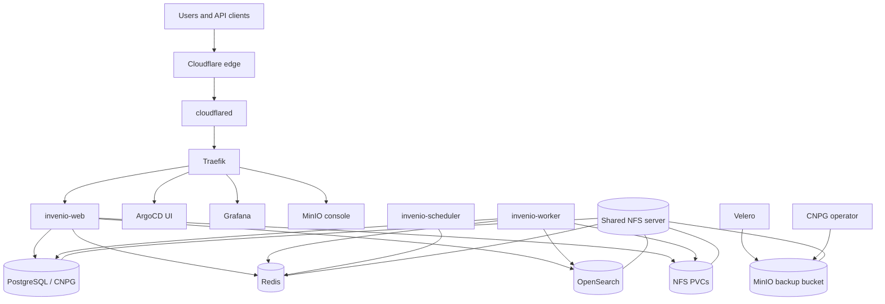
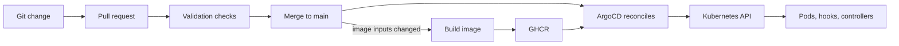

# InvenioRDM GitOps Infrastructure

[](https://github.com/vityasyyy/invenio-rdm-gitops/actions/workflows/validate-infra.yaml)
[](LICENSE)

GitOps configuration for the UGM InvenioRDM research data repository on a
Rancher-managed RKE2 cluster. ArgoCD reconciles the cluster from this repository;
GitHub Actions validates the manifests and builds the custom application image.
The public path is Cloudflare Tunnel, so the cluster needs no inbound firewall
ports.

> New to the system? Read [Understanding this InvenioRDM GitOps
> system](docs/architecture-guide.md) for the request path, ownership boundaries,
> storage, recovery limits, and experiment design.

## Architecture



The two Invenio hostnames terminate at the same `invenio-web` Service; there is
no separate API deployment behind `api-invenio.vityasy.me`. Uploaded file bytes
live on NFS-backed PVCs, while MinIO is the backup object store. All of those
services share one NFS server, so replicas and backups on that server do not
create an independent failure domain.

### Public hostnames and shared edge

| Hostname | Route | Notes |
|---|---|---|
| `invenio.vityasy.me` | Traefik → `invenio-web:8000` → web container `:5000` | UI and REST routes |
| `api-invenio.vityasy.me` | Traefik → the same `invenio-web:8000` | Same application and image |
| `argocd.vityasy.me` | Traefik → ArgoCD server | Control plane UI/API |
| `grafana.vityasy.me` | Traefik → Grafana | Metrics and logs |
| `minio-console.vityasy.me` | Traefik → MinIO console | Backup store administration |

All hostnames share the `vityasy.me` DNS zone and one Cloudflare Tunnel. A DNS,
Cloudflare, or tunnel failure can affect every hostname even while the Kubernetes
workloads are healthy; a healthy Pod is not proof that the public path works.

## Repository map

```text
argocd/
  root.yaml                 # App-of-apps root Application
  apps/                     # 17 child Application definitions
k8s/
  apps/invenio/             # Web, worker, Beat, setup Job, HPA, PDB, PVCs, routes
  apps/invenio-deps/        # PostgreSQL (CNPG), Redis, OpenSearch
  infra/                    # ArgoCD, Image Updater, security, monitoring, Loki,
                            # Alloy, MinIO, Velero, Sealed Secrets, Traefik
external-lb/
  k8s/                      # Cloudflare Tunnel DaemonSet and Service
  scripts/                  # Tunnel bootstrap helper
  terraform/                # Cloudflare tunnel/DNS source
docker/ugm/                 # Application image: Dockerfile, invenio.cfg, uWSGI
site/ templates/ static/ assets/ translations/ app_data/  # Image build inputs
scripts/                    # Bootstrap, verification, CI checks, tests
docs/                       # Architecture guide, dated assessments, plans
.github/workflows/          # Validation, image build, deployment verification
.opencode/                  # Agent conventions and workflow skills
```

`argocd/projects/` does not exist. AppProject RBAC lives in
`k8s/infra/argocd/projects/`.

### Source, generated, and legacy material

| Class | Paths | How to treat it |
|---|---|---|
| **Source of truth** | `argocd/`, `k8s/`, `external-lb/`, `docker/ugm/`, `app_data/`, `assets/`, `static/`, `templates/`, `translations/`, `scripts/`, `.github/workflows/` | Hand-edited, reviewed, and committed. Changes reach the cluster through ArgoCD or an image build. |
| **Generated or runtime-only** | `rendered/` (gitignored CI output), Kubernetes Secrets decrypted from SealedSecrets, Velero `Backup`/`Restore` objects, CNPG `Backup` objects and PVCs, MinIO objects, application data, and an Image Updater override written through the ArgoCD API | Not committed. Do not edit it as if it were Git desired state; verify live ownership before changing it. |
| **Legacy / historical** | `docs/cluster-assessment-*.md`, `docs/plans/completed/`, `site/.gitkeep`, and `k8s/apps/invenio-deps/opensearch/values.yaml` | Dated evidence, placeholders, or a validation mirror. The OpenSearch Application inlines its Helm values; the values file is not the live source. MinIO is no longer the primary application-file store. |

## Delivery and reconciliation



A manifest-only change does not rebuild the image. An image build does not deploy
by itself unless the effective desired digest changes. ArgoCD compares and applies
resources; Kubernetes controllers perform the rollout and hooks run around the
sync operation.

**CI checks** on pull requests to `main`:

| Check | What it validates |
|---|---|
| Validate YAML Syntax | yamllint plus Velero ownership and Python tests |
| Render & Validate Manifests | kustomize/Helm render, kubeconform, selectors, SealedSecret format |
| Validate ArgoCD Applications | kube-linter, source paths, AppProject repository allowlists |
| Verify Sync Wave Ordering | Wave annotations and project/wave sanity |
| Scan for Secrets | gitleaks |
| Validate Monitoring Rules & Dashboards | promtool, amtool, alert/dashboard contracts |

**Deploy verification** on push to `main` waits for ArgoCD applications to report
`Synced` and `Healthy`, then smokes `https://invenio.vityasy.me/ping`. It is not a
revision-aware release gate: its five-minute timeout, single all-green sample, and
lack of PostSync-hook awareness can pass before a slow rollout or setup Job has
actually finished. Use the observed revision and functional checks when the
change matters; see issue #109.

### What ArgoCD owns — and what it does not

| Thing | Source of truth | Runtime owner | Consequence |
|---|---|---|---|
| Manifests, Applications, AppProjects | Git | ArgoCD | A manual managed-field edit is drift and may be reverted by self-heal. |
| Web/worker replica count | HPA bounds in Git | HPA | ArgoCD ignores `/spec/replicas` for both Deployments; a manual replica edit is not the desired-state mechanism. |
| Application image digest | Kustomize pin in Git | Kubernetes pulls the pinned digest | Image Updater can write an override through the ArgoCD API, not Git. Freeze it or pin digests for reproducible experiments. |
| Velero backup schedule | Git `Schedule` | Velero creates `Backup`/`Restore` objects | Generated backup objects are excluded from ArgoCD pruning; backup data lives in MinIO. |
| PostgreSQL backups | Git `Cluster`/`ScheduledBackup` | CNPG operator creates native `Backup` objects and WAL archives | Native DB recovery is separate from Velero filesystem recovery. |
| SealedSecret ciphertext | Git | Sealed Secrets controller | The controller decrypts to a Kubernetes Secret; the private key is outside Git. |
| Research records, files, search documents | Invenio/PostgreSQL/NFS | Invenio and its workers | ArgoCD does not reconcile application data or search documents. |

### HPA and scheduler ownership

- `invenio-web-hpa`: 2–4 replicas, CPU target 70% and memory target 80% of requests.
- `invenio-worker-hpa`: 1–4 replicas, same utilization targets; each worker runs
  Celery concurrency 2.
- `invenio-scheduler`: one replica with `Recreate`. This prevents overlap during a
  normal Deployment revision rollout; it is not a distributed lock or an
  exactly-once task guarantee. The liveness probe checks process presence, not
  scheduling progress.
- PDBs constrain applicable voluntary evictions only. They do not guarantee
  availability during node loss, direct Pod deletion, or a shared dependency failure.

### The setup Job is a PostSync hook

`invenio-setup` runs after the sync, not before new web/worker Pods start. It runs
database initialization/migration, file-location setup, fixtures, queue declaration,
and index rebuilding. Several commands continue on failure (`|| true` or equivalent),
so a successful Job can hide a failed setup step. A green sync is not proof that a
migration completed, that a repeated fixture/rebuild was harmless, or that the
application is functionally correct. Reverting an image does not reverse a database
migration.

## Storage, backup, and recovery

`invenio-data` and `invenio-archive` are `ReadWriteMany` PVCs on the `btd-nfs`
StorageClass, which points at one shared NFS server and uses `Retain`. PostgreSQL,
Redis, OpenSearch, MinIO, Loki, Prometheus, Grafana, and Alertmanager also use
`btd-nfs`. The requested PVC sizes are scheduling/claim requests, not enforced
per-directory quotas, and they do not isolate services from NFS-server loss.

### Backup & Restore

The backup design has three separate pieces:

1. Velero backs up selected Kubernetes resources and opt-in Pod volumes to MinIO.
2. CloudNativePG writes PostgreSQL native backups and WAL to MinIO.
3. Invenio stores uploaded file bytes on the NFS PVCs; these are not in MinIO.

Read-only checks:

```bash
kubectl -n velero get backupstoragelocation default
kubectl -n velero get schedules
kubectl -n velero get backups -o wide
kubectl -n database get clusters.postgresql.cnpg.io postgres
kubectl -n database get backups.postgresql.cnpg.io
```

Before creating or restoring anything, get approval. A restore is a mutation and
can overwrite production data. Use an isolated namespace, never restore into
`invenio`, preserve `Retain` PVs, and verify the seeded record, file checksum,
database state, permissions, and search/index behavior. Do not delete backups or
PVs to make an alert quiet.

| Recovery claim | What the evidence supports |
|---|---|
| Kubernetes resources and selected files via Velero | A weekly schedule exists and manual production/canary backups have completed. The latest actual weekly run observed on 21 October was `PartiallyFailed` (4 errors, 58 warnings); this is not a successful scheduled-backup claim. |
| PostgreSQL native recovery | CNPG backups/WAL go to MinIO. Recovery of existing data into an isolated CNPG cluster was verified by schema, row-count, and vocabulary-digest comparison. No seeded application record/file consistency proof exists. |
| Uploaded-file recovery | A 35,840-byte canary file restored with the same SHA-256 into an isolated namespace. The recovery preflight found production `invenio-data` and `invenio-archive` empty and no production seed has been authorized, so production file recovery is unproven. |
| Application-consistent recovery | Not proven. No seeded Invenio record plus file, permissions, and index state has been restored and verified together. |
| Independent disaster recovery | Not demonstrated. MinIO and the primary NFS data share the same NFS server; an off-site or independent copy is not provided here. |
| RPO/RTO | No contractual guarantee. Velero is weekly, CNPG is more frequent, and actual restore time depends on data size, credentials, storage, and operator behavior. |

See [Storage and recovery](docs/architecture-guide.md#13-storage-and-recovery)
for the failure-domain diagram and the evidence boundaries.

## Operations

### Incident Triage

Start read-only and follow the failing boundary. Do not restart, purge, reindex,
or delete storage merely to clear an alert.

```bash
# Control plane and ArgoCD
kubectl -n argocd get applications
kubectl get pods -A --field-selector=status.phase!=Running

# Invenio and dependencies
kubectl -n invenio get all
kubectl -n invenio describe deploy invenio-web
kubectl -n invenio logs deploy/invenio-web --tail=200
kubectl -n invenio get svc invenio-postgresql invenio-redis invenio-search
kubectl -n minio get svc minio

# Edge and ingress
kubectl -n kube-system get ds cloudflared
kubectl -n traefik get pods,svc
kubectl get ingressroutes -A
```

| Symptom | Start with |
|---|---|
| Git change not deployed | Application source/revision, render errors, sync operation, hooks |
| Pods Pending | Scheduling events, requests, PVCs, node capacity |
| Container not starting | Image pull status, command, config, container logs |
| App Ready but operation fails | Actual API response, DB/index state, task path |
| Public URL fails, internal works | Cloudflare, tunnel, Traefik, IngressRoute |
| Empty dropdown | Vocabulary API, DB rows, search index, indexing queue |
| Tasks accumulate | Queue routing, consumer subscriptions, failures, observed progress |
| Backup says Completed | Restore test and data consistency, not status alone |

Logging uses one non-root Alloy collector reading Invenio Pod logs through the
Kubernetes API, restricted by a Role in `invenio`; Loki serves queries on port
3100 and Grafana provisions the `loki` datasource. Retention is seven days, but
the 10Gi PVC is a request, not a hard byte cap. Collector restarts can replay
logs; this is not an audit-log guarantee. Log-pipeline alerts cover missing
scrape signals, recent drops, push retries/server errors, and a stalled or failing
canary. The canary's two-minute acknowledgement window recognizes normal hourly
tail replay; it does not prove zero loss under sustained load.

The scheduler and log pipeline are operationally important but not health
guarantees: a healthy Beat process does not prove task progress, and a Ready
canary does not prove every log entry survived. See
[Troubleshooting](docs/architecture-guide.md#19-troubleshooting-and-glossary) and
[metrics, logs and alerts](docs/architecture-guide.md#14-metrics-logs-and-alerts)
for the detailed limits.

### Secret rotation

Only SealedSecret ciphertext is committed. Plaintext stays local under
`secrets/` (gitignored). Back up the Sealed Secrets private key independently;
without it the encrypted values cannot be recovered.

```bash
# Rotate Invenio secrets
INVENIO_SECRET_KEY="$(openssl rand -hex 32)" ./scripts/generate-sealed-secrets.sh invenio

# Rotate infrastructure secrets
./scripts/generate-sealed-secrets.sh minio grafana velero
```

### Quick start and bootstrap

```bash
# 1. Verify prerequisites and current access
./scripts/verify-infra.sh

# 2. Install ArgoCD once on a clean cluster
./scripts/bootstrap-infra.sh

# 3. Create/activate the Cloudflare tunnel credentials
./external-lb/scripts/bootstrap-dev.sh

# 4. Confirm ArgoCD and the public path
./scripts/verify-infra.sh
kubectl -n argocd get applications
```

Bootstrap is an imperative exception: it installs ArgoCD, after which the
app-of-apps root manages the remaining Applications. A working cluster, access
credentials, and the root Application must already exist for self-management to
start. Recovery must not depend exclusively on a working ArgoCD installation.

## Access and services

| Service | URL / endpoint | Authentication |
|---|---|---|
| ArgoCD UI | `https://argocd.vityasy.me` | `argocd-initial-admin-secret` |
| Grafana | `https://grafana.vityasy.me` | SealedSecret `monitoring-grafana` |
| MinIO console | `https://minio-console.vityasy.me` | SealedSecret `minio-credentials` |
| MinIO S3 API | `minio.minio.svc.cluster.local:9000` | Internal only |
| Invenio RDM | `https://invenio.vityasy.me` | Invenio accounts |
| Invenio API | `https://api-invenio.vityasy.me` | Invenio accounts |

## Security

- Cloudflare Tunnel makes outbound-only connections; no inbound firewall ports.
- SealedSecrets keep only ciphertext in Git; the controller's private key is
  stored outside the repository and must be backed up separately.
- Pod Security Admission, default-deny NetworkPolicies, non-root containers,
  dropped capabilities, and `seccompProfile: RuntimeDefault` are configured in
  `k8s/infra/security/` and the workload manifests.
- Network reachability, Kubernetes API authorization, ArgoCD RBAC, and Invenio
  roles are separate boundaries. Application administration does not grant
  cluster administration.

## Contributing

1. Create a branch from `main` and open a pull request; every change starts with
   an issue and follows the repository's issue-to-PR workflow.
2. Update the affected docs and plan index in the same PR.
3. Wait for the required validation checks; a docs-only PR still runs them.
4. Merge with squash merge, then verify ArgoCD converged on the intended revision.
5. Do not push secrets, rendered output, `WORKER-REPORT.md`, or planning artifacts
   into the product history.

## License

MIT
