# Understanding this InvenioRDM GitOps system

> Repository-specific reference, prepared 21 October 2026.
> Repository claims were re-checked against revision `d135493` and read-only cluster state on 21 October 2026; older dated findings remain labelled as such. This is not a live health report, a recovery certification, or a guarantee that the cluster is currently healthy.

Open this file in Vim/Neovim and run `:MarkdownPreview`. Diagrams use Mermaid; the preview renderer must support Mermaid fenced blocks.

## Contents

1. [The essential mental model](#1-the-essential-mental-model)
2. [Repository map](#2-repository-map)
3. [Machines and Kubernetes](#3-machines-and-kubernetes)
4. [Kubernetes objects and controllers](#4-kubernetes-objects-and-controllers)
5. [ArgoCD internals](#5-argocd-internals)
6. [App-of-apps and bootstrap](#6-app-of-apps-and-bootstrap)
7. [Helm, Kustomize and delivery](#7-helm-kustomize-and-delivery)
8. [Sync, health and ownership](#8-sync-health-and-ownership)
9. [Request routing](#9-request-routing)
10. [Invenio application architecture](#10-invenio-application-architecture)
11. [Vocabulary repair and application data](#11-vocabulary-repair-and-application-data)
12. [Setup hooks and migrations](#12-setup-hooks-and-migrations)
13. [Storage and recovery](#13-storage-and-recovery)
14. [Metrics, logs and alerts](#14-metrics-logs-and-alerts)
15. [Security and access boundaries](#15-security-and-access-boundaries)
16. [GitOps, hardcoding and direct operations](#16-gitops-hardcoding-and-direct-operations)
17. [Designing valid ArgoCD experiments](#17-designing-valid-argocd-experiments)
18. [Dated findings and remaining work](#18-dated-findings-and-remaining-work)
19. [Troubleshooting and glossary](#19-troubleshooting-and-glossary)

## 1. The essential mental model

**ArgoCD manages desired configuration. Kubernetes maintains workloads. Invenio manages research data.** They cooperate, but they do not repair the same failures.

| Layer | Responsibility | Examples |
| --- | --- | --- |
| University infrastructure | Machines, physical/virtual networking and storage | VMs, NFS server, host maintenance |
| Kubernetes | Schedule and maintain container workloads | API server, Deployments, Pods, Services |
| ArgoCD | Reconcile declared configuration against Git | Applications, sync, drift correction |
| InvenioRDM | Research-repository behavior | Accounts, drafts, publication, files, search |
| Data services | Persistence and asynchronous processing | PostgreSQL, Redis, OpenSearch |
| Operations | Observation and recovery | Prometheus, Grafana, Loki, Velero, MinIO |

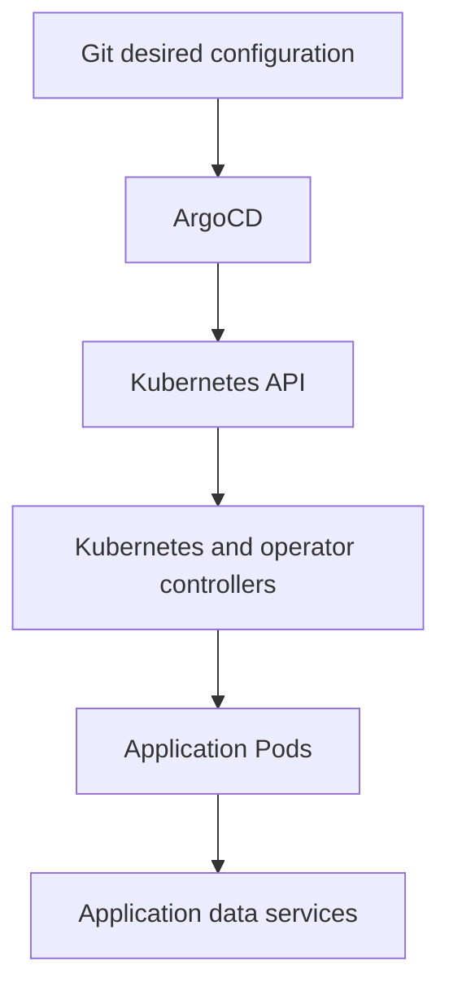

Git describes resources; ArgoCD submits them to Kubernetes. Kubernetes and operators make them run, while application data remains a distinct responsibility.

Two consequences underpin the entire system:

- **A recovered Pod does not necessarily demonstrate ArgoCD recovery.** Kubernetes can replace it by itself.
- **Synced and Healthy does not prove application correctness or recoverability.** An empty search index can coexist with healthy web Pods.

## 2. Repository map

This is primarily a deployment/operations repository, but it also builds a customized Invenio application image.

| Location | Purpose |
| --- | --- |
| `argocd/root.yaml` | Root Application |
| `argocd/apps/` | Child Application definitions |
| `k8s/infra/argocd/` | ArgoCD installation, configuration and projects |
| `k8s/infra/argocd-image-updater/` | Image registry automation |
| `k8s/apps/invenio/` | Web, workers, Beat, setup, configuration, storage and routes |
| `k8s/apps/invenio-deps/` | PostgreSQL, Redis and OpenSearch |
| `k8s/infra/security/` | Network policies and related governance |
| `k8s/infra/monitoring/` | Alerts, dashboards and monitoring configuration |
| `k8s/infra/loki/` | Logging backend and canary configuration |
| `k8s/infra/alloy/` | Log collector and scoped permissions |
| `k8s/infra/velero/` | Kubernetes and filesystem backup policy |
| `k8s/infra/minio/` | Backup object storage |
| `external-lb/k8s/` | Cloudflare Tunnel workloads |
| `docker/ugm/` | Image build, dependencies, Invenio and uWSGI configuration |
| `site/`, `templates/`, `static/`, `assets/` | Application customization |
| `.github/workflows/` | Validation, image build and deployment verification |
| `scripts/` | Bootstrap, verification, CI checks and tests |
| `.opencode/` | Agent conventions and workflow skills |

`argocd/projects/` does not exist; the AppProject definitions are under `k8s/infra/argocd/projects/`.

### Source, generated and legacy material

| Class | Paths | Meaning |
| --- | --- | --- |
| Source of truth | `argocd/`, `k8s/`, `external-lb/`, `docker/ugm/`, `app_data/`, `assets/`, `static/`, `templates/`, `translations/`, `scripts/`, `.github/workflows/` | Hand-edited and reviewed. Changes reach the cluster through ArgoCD or an image build. |
| Generated or runtime-only | `rendered/` (gitignored CI output), Kubernetes Secrets produced by Sealed Secrets, Velero `Backup`/`Restore` objects, CNPG `Backup` objects and PVCs, MinIO objects, application data, and an Image Updater override written through the ArgoCD API | Not committed as desired state. Inspect ownership before changing it; a controller may recreate or overwrite it. |
| Legacy / historical | `docs/cluster-assessment-*.md`, `docs/plans/completed/`, `site/.gitkeep`, `k8s/apps/invenio-deps/opensearch/values.yaml` | Dated evidence, placeholders, or a validation mirror. The OpenSearch Application inlines its Helm values, so that values file is not the live source. MinIO is no longer the primary application-file store. |

An image-baked configuration change, such as `docker/ugm/invenio.cfg`, requires a new image and deployment. A manifest-only change, an application ConfigMap change, or a live image-updater override follows a different path and does not necessarily rebuild the image.

## 3. Machines and Kubernetes

The inspected cluster runs RKE2 in the university/Rancher environment:

- Control plane: `ubuntu-btd-kubernetes-server`.
- Workers: `ubuntu-btd-kubernetes-worker-01` and `ubuntu-btd-kubernetes-worker-02`.
- Shared NFS endpoint: `10.17.117.48`.

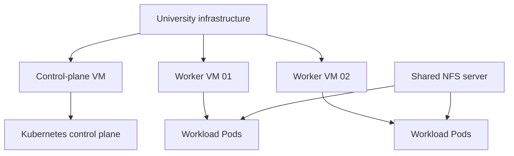

Kubernetes is software on the machines, not a replacement for them. ArgoCD is itself a Kubernetes workload, not a VM manager or an operating-system repair service.

| Component | Responsibility |
| --- | --- |
| API server | Accept and authorize Kubernetes API operations |
| etcd | Persist Kubernetes object state |
| Kubernetes scheduler | Assign unscheduled Pods to suitable nodes |
| Controller manager | Reconcile built-in Kubernetes resources |
| kubelet | Manage containers and probes on a node |
| containerd | Pull images and execute containers |
| CoreDNS | Resolve cluster service names |
| Cluster networking | Provide Pod connectivity and enforce supported network policies |
| NFS CSI driver | Provision and mount NFS-backed volumes |
| metrics-server | Supply resource metrics used by HPA and `kubectl top` |

**etcd is not PostgreSQL:** etcd stores Kubernetes state; PostgreSQL stores Invenio data. Restoring one does not restore the other.

**There are also two schedulers:** Kubernetes schedules Pods onto nodes; Celery Beat schedules application tasks into a broker.

## 4. Kubernetes objects and controllers

Kubernetes controllers repeatedly compare desired and observed state. They act when the two differ; reconciliation is continuous, not a single deployment command.

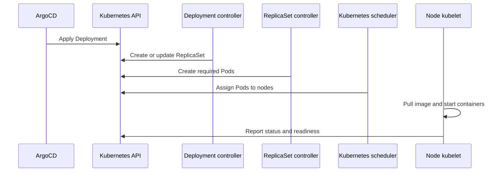

ArgoCD does not directly launch containers. It declares resources; other controllers and node agents carry out those declarations.

| Object | Meaning in this system |
| --- | --- |
| Deployment | Maintains replaceable web, worker, Beat or collector Pods |
| ReplicaSet | Maintains the requested number of Pods for a Deployment |
| Pod | Runs one or more containers with shared networking and volumes |
| StatefulSet | Gives workloads stable identities and storage associations |
| DaemonSet | Runs a Pod on eligible nodes |
| Job | Performs finite work, such as setup |
| Service | Provides a stable network endpoint over changing backend Pods |
| IngressRoute | Defines Traefik HTTP routing |
| ConfigMap | Stores non-secret configuration |
| Secret | Stores sensitive configuration; access still requires protection |
| PVC | Requests persistent storage |
| PV | Represents provisioned storage |
| HPA | Adjusts replicas using configured metrics |
| PDB | Constrains applicable voluntary evictions |
| NetworkPolicy | Restricts network reachability where enforced |
| Custom Resource | Requests behavior from an installed operator |

A CloudNativePG `Cluster` custom resource describes a PostgreSQL cluster, not the whole Kubernetes cluster. Its operator creates and maintains the corresponding database resources.

### Probes and resources

- **Readiness:** should this Pod receive Service traffic?
- **Liveness:** should this container be restarted?
- **Startup:** has slow initialization completed before other probes take over?
- **CPU/memory requests:** scheduling reservations and inputs to utilization-based HPA.
- **Limits:** runtime constraints; memory-limit breaches can cause OOM termination, while CPU limits can throttle work.

A passing probe checks only what its command or endpoint checks. A process-level probe does not establish queue progress, correct search contents or file consistency.

## 5. ArgoCD internals

ArgoCD asks: what should exist, what currently exists, what differs, should it be applied, and did resources become healthy?

| Component | Role |
| --- | --- |
| Application controller | Compare desired/live resources and coordinate reconciliation |
| Repository server | Fetch Git/chart sources and render desired manifests |
| API server/UI | Expose user operations, authentication and status |
| ArgoCD Redis | Cache ArgoCD-related state |
| Dex | Support configured identity-provider integrations |
| ApplicationSet controller | Generate Applications from templates where used |
| Notifications controller | Support configured ArgoCD notifications |
| Image Updater | Separate automation that watches image registries |

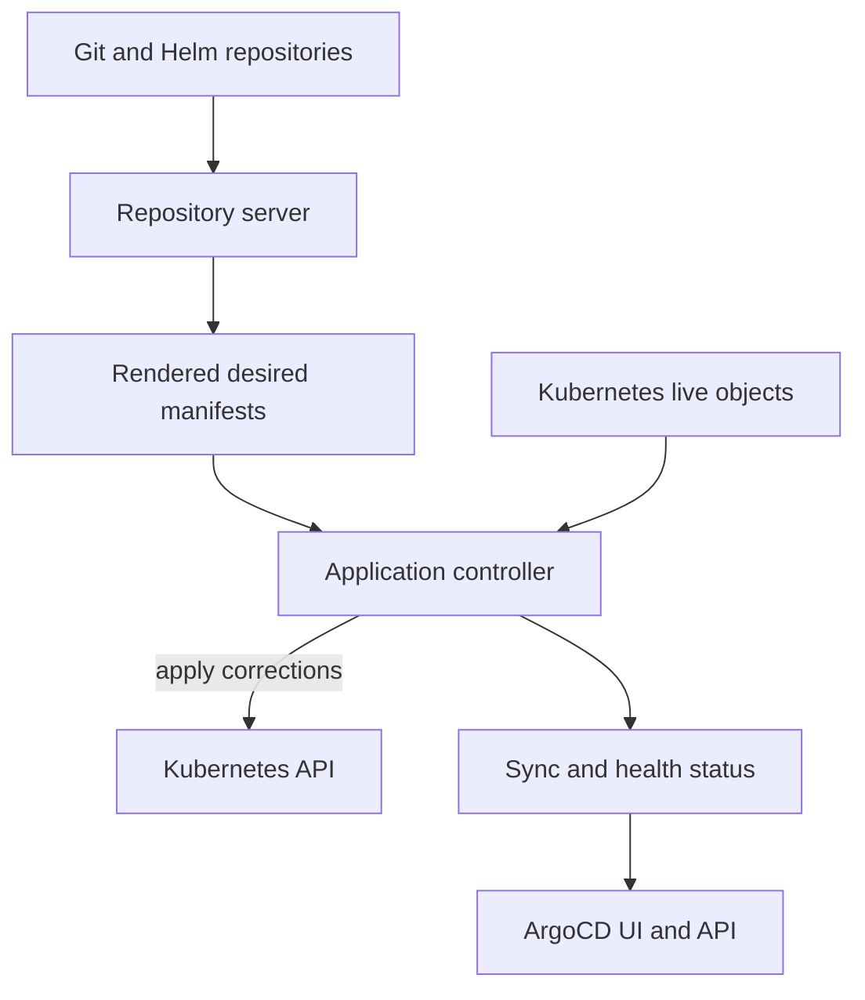

The controller reconciles resources; the UI displays its state. ArgoCD Redis and Invenio Redis are separate services with different responsibilities.

ArgoCD is **not in the researcher request path**. If it stops, existing workloads can continue serving and Kubernetes can still replace Pods, provided the underlying cluster remains functional. Git-driven changes and ArgoCD drift correction are impaired.

## 6. App-of-apps and bootstrap

`argocd/root.yaml` defines the root Application named `apps`, tracking `main` at `argocd/apps`. At inspection time it managed 17 child Applications: 18 Applications including the root.

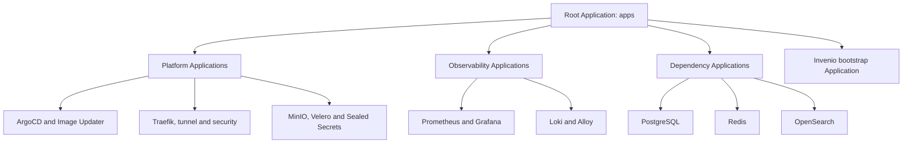

The category boxes explain the structure; they are not extra resources. Each actual child Application has its own source, destination, sync policy and health.

Examples include `argocd-self`, `security-policies`, `traefik`, `cloudflared`, `invenio-postgresql`, `invenio-redis`, `invenio-opensearch`, `invenio-bootstrap`, `monitoring`, `monitoring-extras`, `loki`, `alloy`, `velero`, `minio` and `minio-extras`.

Self-management starts **after bootstrap**. A working Kubernetes cluster, credentials, initial ArgoCD installation and root Application must already exist. Recovery also needs an access path that does not depend exclusively on a working ArgoCD installation.

## 7. Helm, Kustomize and delivery

### Rendering tools

**Kustomize** assembles and transforms Kubernetes YAML. In `k8s/apps/invenio/kustomization.yaml`, image overrides pin the effective image digest even if a base Deployment says `:latest`.

**Helm** renders chart templates using values. ArgoCD manages the resulting objects; Helm is not another continuously running controller in this rendering path.

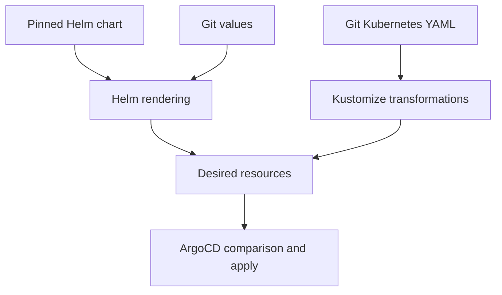

Both tools ultimately produce Kubernetes objects. Valid YAML and successful rendering do not prove the intended service was actually rendered; the earlier Loki configuration lacked a backend despite other chart resources existing.

### Delivery path

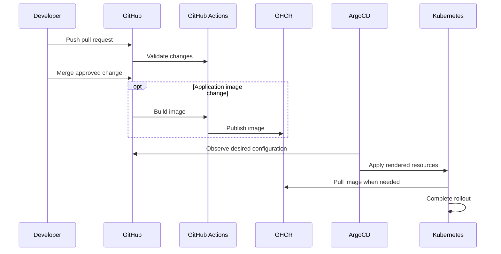

A manifest-only change need not build an image. Publishing an image also does not deploy it if the effective desired digest remains unchanged.

### Image Updater introduces another authority

The configured updater watches Invenio's `latest` tag using digest updates and `writeBackConfig.method: argocd`: **ArgoCD API write-back, not Git write-back**.

API write-back patches the ArgoCD `Application` object through the API. It does not create a commit. Because the root Application also manages the child `Application` manifests from Git, an API-written override can be reported as drift or reverted by reconciliation. The 21 October audit observed no active image override (`imagesManaged: 0`) and the live image matched the Git-pinned digest, but that is a snapshot, not a guarantee. For reproducible experiments, freeze Image Updater or pin an immutable digest; never treat an API write-back as durable Git desired state.

## 8. Sync, health and ownership

| State | Meaning |
| --- | --- |
| Synced + Healthy | Desired objects match and configured resource health checks pass |
| OutOfSync + Healthy | Resources differ, but the current workload may still function |
| Synced + Progressing | Desired configuration is applied; rollout is incomplete |
| Synced + Degraded | Desired resources exist, but health is failing |

Synced and Healthy does not guarantee correct data, functioning dropdowns, successful tasks, consistent files, restorable backups or high availability.

### Automatic sync and self-healing

Most Applications enable automated sync, pruning and self-healing. Self-healing can correct relevant drift in managed fields. The configured reconciliation interval was `30s`; that is not a promise that every application repair completes in 30 seconds. Rendering, controller processing, scheduling, pulls, probes and hooks add time.

Not every live difference should be corrected. Web/worker replicas are intentionally HPA-owned, with replica comparison exclusions. HPA scaling is expected controller behavior, not automatically unauthorized drift.

### Pruning and generated resources

Pruning can delete managed resources removed from desired state. Consequences depend on owner references, finalizers, operators, PVC lifecycle and storage reclaim policies.

An earlier Velero ownership problem caused generated Backup objects to be mistaken for ArgoCD-managed resources. Current exclusions keep Velero `Backup` and `Restore` objects outside ArgoCD management while leaving backup `Schedule` policy Git-managed.

- Git/ArgoCD owns policy.
- Velero owns generated backup operations.
- MinIO holds backup data.

### Waves are not complete dependency guarantees

Sync waves order resources within a sync operation. App-of-apps ordering does not by itself prove that child services are ready. The inspected configuration had no custom Application health assessment providing a comprehensive child-readiness barrier.

**Root Application synced is not equivalent to every application and hook having completed successfully.**

## 9. Request routing

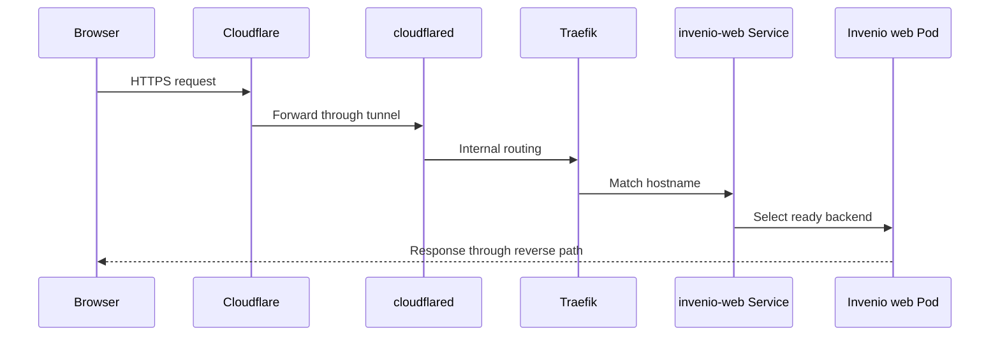

ArgoCD maintains configuration for this path but does not handle the request. A failure at the public edge can differ from an origin application failure.

Both `invenio.vityasy.me` and `api-invenio.vityasy.me` route to `invenio-web:8000`, which forwards to web containers on port `5000`. ArgoCD, Grafana and the MinIO console use separate IngressRoutes but share the same `vityasy.me` DNS zone and Cloudflare Tunnel. A DNS, Cloudflare or tunnel failure can therefore affect several services even when their Pods are healthy.

The web process uses `uwsgi --ini /opt/invenio/var/instance/uwsgi_ui.ini`. Despite that filename, it loads `invenio_app.wsgi:application`, serving UI and REST routes. There is no separately deployed API backend behind the API hostname.

Test availability in layers:

1. Service endpoint reachable.
2. Internal application health endpoint responds.
3. Traefik hostname routing works.
4. Cloudflare permits the client.
5. The intended browser/API operation succeeds.

An automated public client encountered Cloudflare 1010 during investigation while authorized origin checks succeeded. Neither result alone establishes the complete browser experience.

## 10. Invenio application architecture

The same customized Python/InvenioRDM image runs several roles:

| Role | Responsibility |
| --- | --- |
| Web | Browser and REST requests |
| Celery workers | Asynchronous tasks |
| Celery Beat | Periodic task enqueueing |
| Setup Job | Database/application initialization and update commands |

| Backend | What it holds |
| --- | --- |
| PostgreSQL | Accounts, drafts/records, file metadata, vocabularies and application state |
| NFS | Uploaded file bytes and mounted durable filesystem content |
| OpenSearch | Searchable representations derived from application data |
| Redis | Broker messages, sessions, task results and caches |
| MinIO | Backup objects here, not the primary research-file store |

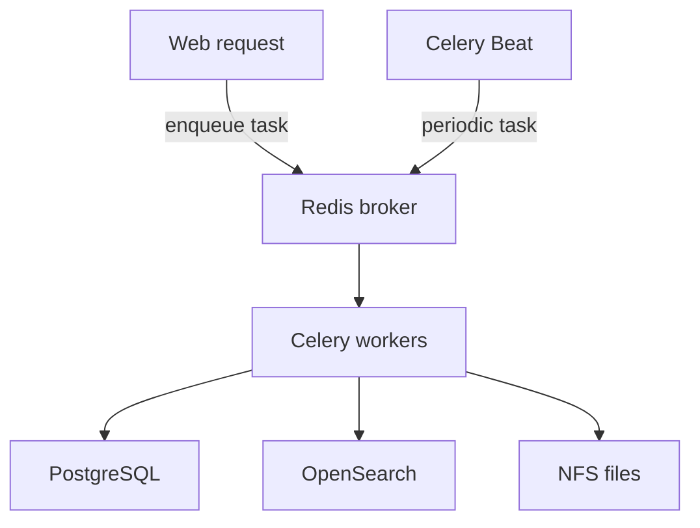

Request handling and task execution are separate paths. Healthy worker processes do not prove every queue is consumed or every task is successful.

### Scaling and scheduler behavior

At inspection:

- Web HPA: 2–4 replicas.
- Worker HPA: 1–4 replicas.
- Worker concurrency: 2 per Pod.
- Beat: one replica, with `Recreate` for Deployment revision rollouts.

HPA utilization targets are relative to requests, not limits. With a 250m CPU request, a 70% target corresponds to roughly 175m per Pod, not 70% of a 1-core limit.

Beat's `Recreate` prevents normal revision-rollout overlap; it is not distributed locking or exactly-once task execution. Queue redelivery and task idempotency remain separate concerns.

PDBs constrain applicable voluntary evictions. They do not guarantee availability during machine loss, direct Pod deletion or shared dependency failure, and they are not substitutes for Deployment rollout strategy.

## 11. Vocabulary repair and application data

The empty resource-type dropdown was not caused by missing source vocabulary rows. PostgreSQL contained 9,138 rows, while the derived vocabulary index was empty.

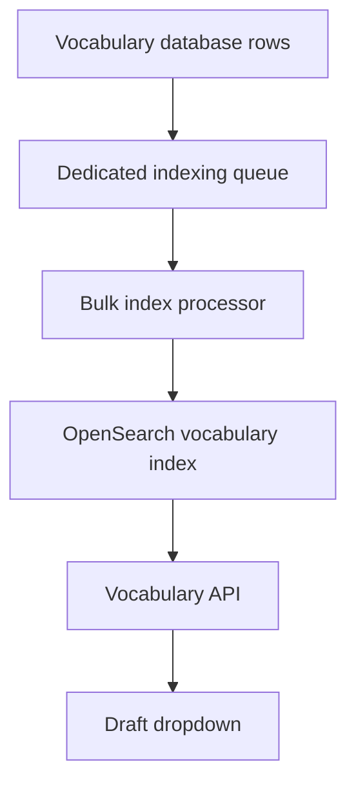

The form depends on the searchable representation. A healthy database and healthy web process therefore did not guarantee dropdown contents.

The approved operational repair used the installed vocabulary service's `rebuild_index(system_identity)` and a bounded bulk processor on the dedicated `vocabularies` queue.

Verified results:

- Database rows stayed at 9,138.
- Active logical index count became 9,138.
- Resource-type API returned 45 options, including `dataset`.
- Language API returned 7,847 options.
- One bounded processing run completed 10,000 actions without errors.

No global reindex, fixture reload, research-record deletion or Kubernetes configuration change was performed.

**ArgoCD does not normally reconcile OpenSearch documents or Redis messages.** It therefore does not undo this repair merely by comparing Kubernetes manifests. But a Git-managed Job can execute commands that change application data, so hooks must be reviewed separately.

About 264,000 existing vocabulary queue messages remained after the bounded run. Messages are actions, not necessarily unique records. No purge or unbounded drain was authorized; durable bulk-index processing remains a follow-up.

## 12. Setup hooks and migrations

`k8s/apps/invenio/invenio-setup-job.yaml` is an ArgoCD PostSync hook. Its commands include database initialization/migration, default file location and permissions, index initialization, custom fields, fixtures, queue declaration and record-index rebuilding.

Several commands swallow errors using `|| true` or equivalent continuation. Consequently:

- A successful Job can hide a failed setup operation.
- A green sync is not sufficient functional proof.
- A PostSync migration is not a migration completed before new application Pods start.
- A comment saying “idempotent” does not establish safe repeated effects.

No explicit index-drop command was observed, so ordinary sync was not shown to erase the vocabulary repair. Repeated fixture/rebuild effects and their queue impact still need investigation.

Schema evolution should explicitly address old/new application compatibility, migration failure visibility, ordering and rollback limitations. Reverting an image does not automatically reverse a database migration.

## 13. Storage and recovery

### Logical claims versus physical storage

| Claim/service | Requested capacity at inspection |
| --- | --- |
| Invenio data | 20Gi |
| Invenio archive | 20Gi |
| PostgreSQL | 10Gi |
| Redis | 5Gi |
| OpenSearch | 10Gi |
| MinIO | 20Gi |
| Loki | 10Gi |

The `btd-nfs` StorageClass uses `nfs.csi.k8s.io`, points to `10.17.117.48:/export/kube-btd/`, and has `Retain` reclaim policy.

These PVC sizes are not independently enforced filesystem quotas in this setup. An archive mount is also not an independent backup just because it is named “archive.”

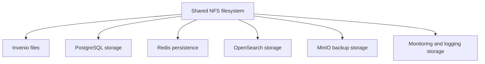

Logically separate services share a physical failure domain. Extra replicas do not remove the shared storage dependency, and backups on that storage do not protect against its complete loss.

### Who backs up what?

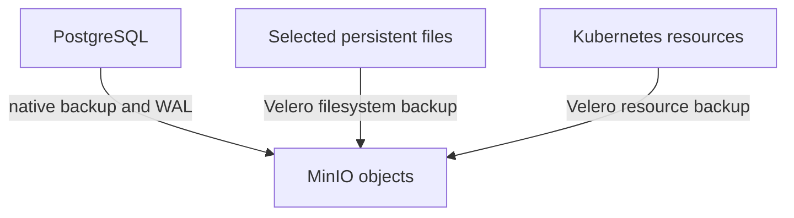

CNPG native database recovery and Velero resource/filesystem recovery serve different purposes. A running restored database alone does not prove consistency with uploaded files.

| Recovery claim | Evidence boundary |
| --- | --- |
| Kubernetes resources and selected files via Velero | Weekly schedule and manual/canary Backups exist. The latest actual weekly run at the 21 October audit was `PartiallyFailed` (4 errors, 58 warnings); backup status is not restore proof. |
| PostgreSQL native recovery | Native restore of existing data into an isolated CNPG cluster matched schema, row counts and a vocabulary content digest. It did not include a seeded application record or file. |
| Uploaded-file recovery | A 35,840-byte canary file restored with the same SHA-256. The owner approved a private draft with a deterministic 64 KiB file, save-only with no publication or DOI; the upload/save ID is still awaited and no seeded restore has completed. Production-file recovery is unproven. |
| Application-consistent recovery | Not proven: the approved private draft/64 KiB seed has not yet been uploaded, saved, backed up and restored together with permissions, publication state and search/index behavior. |
| Independent disaster recovery | Not demonstrated. MinIO and primary NFS data share the same NFS server; no off-site or independent copy is established here. |
| RPO/RTO | No guarantee. Velero is weekly, CNPG is more frequent, and restore time varies with data size, credentials, storage and operator behavior. |

- PostgreSQL uses native CNPG backups and WAL handling.
- Velero targets selected Kubernetes resources and opt-in filesystem data.
- OpenSearch contains derived data, but rebuilding it must be tested.
- RKE2/etcd recovery is a separate control-plane concern.
- Bootstrap credentials and Sealed Secrets decryption keys need independent protection.

### What recovery must prove

A useful seeded test checks a known draft/record, its permissions, associated file metadata, exact file bytes/checksum, and relevant indexing behavior after restore. It also proves that the experiment can return to the same baseline. The approved seed scope is one private draft with a deterministic 64 KiB file, save-only and without publication or DOI; the upload/save ID is pending, and a restore has not yet been completed.

A private-draft test does not prove published-record, DOI or public-search recovery. Backup completion is evidence of backup execution, not proof of successful restoration.

## 14. Metrics, logs and alerts

### Metrics path

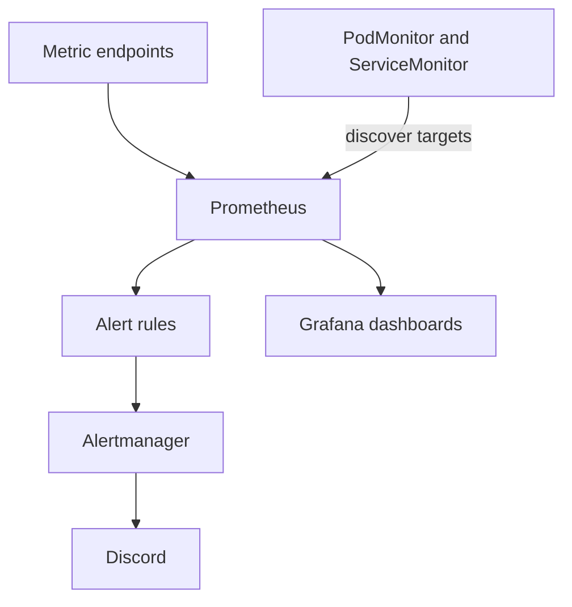

Monitor resources configure discovery; they do not create endpoints or guarantee the expected metric labels exist. Alertmanager groups/routes alerts, while Grafana visualizes data.

### Log path

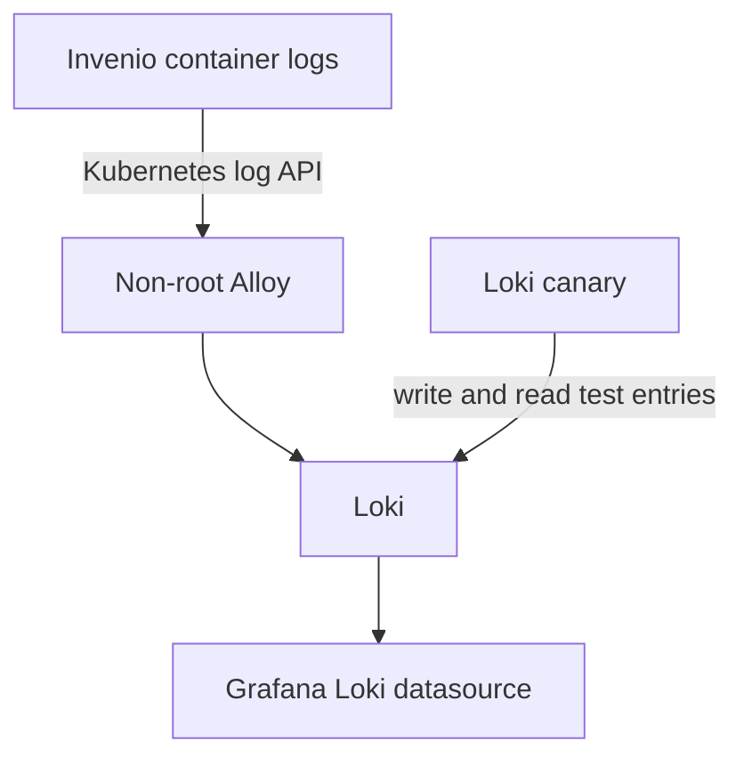

Alloy reads authorized Invenio Pod logs through the API, without host log mounts. Loki stores/query-serves logs; the canary independently exercises its write/read path.

An UP scrape target is not proof of every series, and a Ready canary is not proof of zero lost entries. Alert resolution means the alert expression no longer meets its firing condition, not that every underlying risk is eliminated.

### Retention-edge replay filter

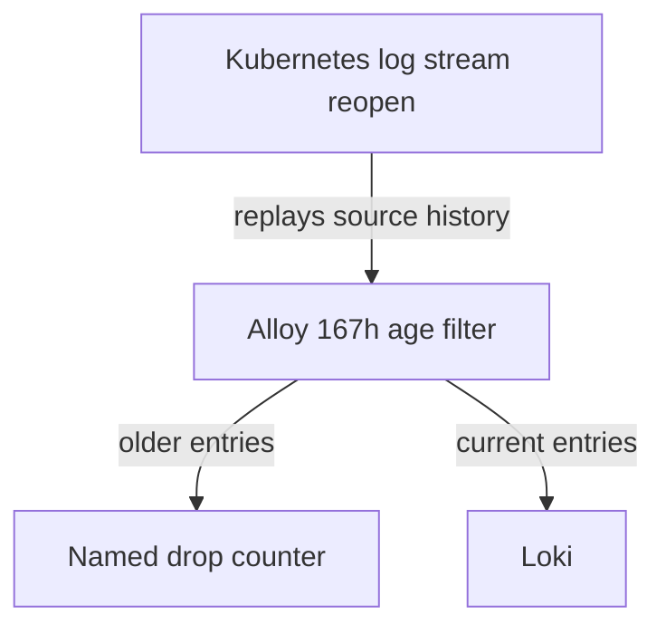

The Kubernetes log API stream can reopen and resume from an older source position instead of the last read position. Recurrence is intermittent; hourly observations do not make it an hourly guarantee. Alloy therefore drops entries older than 167h before the Loki write, with `drop_counter_reason = "older_than_loki_reject_window"`. The filter is per entry, so mixed batches keep current entries. The named signal is `loki_process_dropped_lines_total{reason="older_than_loki_reject_window"}`.

This is an intentional tradeoff, not lossless backfill: up to one hour of retention-edge history is discarded so entries cannot cross Loki's unchanged 168-hour `reject_old_samples_max_age` boundary in flight, and Loki retention stays 168 hours. A batch containing only aged entries is discarded entirely. The generic `loki_write_dropped_entries_total{reason="ingester_error"}` remains available for real write failures, and no alert is weakened.

The remaining limitation is the source replay itself: Alloy still reopens the Kubernetes API stream without a supported resume-from-last-position control, so recent history can replay and duplicate, while history older than the cutoff is intentionally lost. This filter bounds what reaches Loki; it does not repair source position tracking.

### The hourly replay correction

Loki canary v3.3.2 reconnects at the hourly tail limit. Replayed entries older than its previous 60-second acknowledgement retention were misclassified as unexpected. The deployed `-wait=2m` retains acknowledgements longer; the final missing-entry window remains five minutes.

On 20 October around 20:22 UTC+7, both natural reconnects were logged, with zero unexpected/missing-entry log reports, 99–100 replay duplicates, Ready status and zero restarts. The subsequent Prometheus query returned HTTP 400, so **full metric/alert verification remained incomplete**. A read-only range query on 21 October showed websocket-missing increments after the canary fix while the HTTP missing-entry counter remained zero. That is a websocket-path gap, not evidence of global log loss: the HTTP missing-entry counter stayed zero (the fallback path reported no loss), and a websocket-only counter must not be used alone to claim entries were lost globally. Sustained natural-reconnect verification remains open in #140; neither a Ready canary nor one clean cycle is a lossless-log guarantee.

## 15. Security and access boundaries

| Identity/control | Governs |
| --- | --- |
| University/SSH/sudo | Host administration |
| Rancher/Kubernetes identity | Kubernetes API permissions |
| ServiceAccount and RBAC | Workload API permissions |
| ArgoCD user RBAC | Operations through ArgoCD |
| ArgoCD AppProject | Allowed sources, destinations and resource types |
| NetworkPolicy | Network reachability |
| Invenio account/roles | Research-data operations |
| Cloudflare policy | Public-edge access |

Application administration does not grant Kubernetes administration. Network reachability does not grant API authorization, and API authorization does not automatically grant network reachability.

### Sealed Secrets

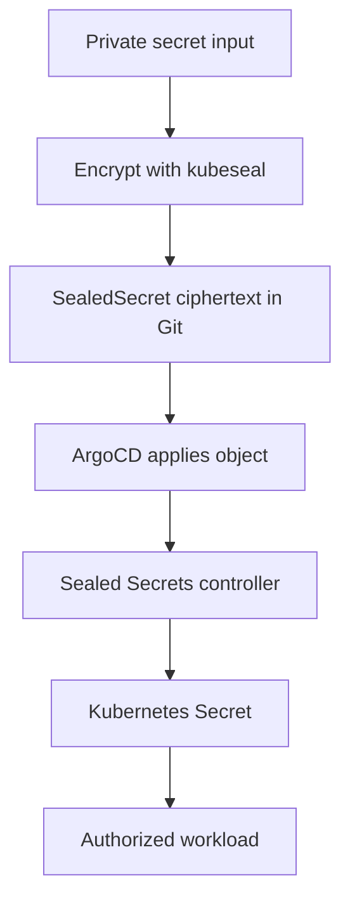

Git can contain encrypted configuration rather than plaintext. The controller's private key still requires independent recovery protection; Kubernetes Secret encoding alone is not encryption.

Invenio password hashes live in application data, not normally as plaintext Kubernetes Secrets. Account confirmation and SMTP delivery are also separate capabilities.

### Cluster access is not host access

| Task | Kubernetes access generally enough? |
| --- | --- |
| Inspect Pods, events and permitted logs | Yes |
| Deploy through ArgoCD | Yes, with appropriate permissions |
| Inspect workload metrics | Yes |
| Manage permitted backup resources | Usually |
| Diagnose physical disk/kernel faults | Only partial evidence |
| Repair RKE2 or host OS services | Generally no |
| Change university infrastructure | No |
| Repair external NFS | No |

University IT is needed for host maintenance and infrastructure repair where the operator lacks host access. Creating a container is not authorization to bypass university host-access policy.

## 16. GitOps, hardcoding and direct operations

Three independent distinctions matter:

- **Hardcoded versus parameterized:** how a value is represented.
- **Declarative versus imperative:** how a change is expressed.
- **GitOps versus out-of-band:** where desired-state authority and reconciliation live.

| Operation | Meaning |
| --- | --- |
| Fixed IP in Git-managed NetworkPolicy | Hardcoded but still GitOps |
| Digest pinned in Kustomize | Reproducible declarative desired image |
| Manual managed Deployment edit | Usually drift, potentially reverted by ArgoCD |
| HPA replica adjustment | Intended controller-owned runtime behavior |
| User saves a draft | Application data, not manifest drift |
| Approved vocabulary reindex | Operational derived-data repair |
| Manual edit of controller-owned Secret | Competing ownership; controller may overwrite it |
| Edit a file inside a container | Usually ephemeral and lost on replacement |

Hardcoded values can be appropriate in a fixed environment but create coupling. They are not inherently the opposite of ArgoCD.

For a direct operation, ask: **which object or data changed, who owns it, will a controller overwrite it, and must the change be made durable in Git?**

### ConfigMap adoption trap

Changing a ConfigMap does not update environment variables already loaded into a running process. The ConfigMap may be Synced while old Pods still use old values. Mounted-file behavior differs, but the application must still reload or reread configuration as appropriate.

Without an explicit rollout/reload mechanism, object convergence is not proof of effective application configuration.

## 17. Designing valid ArgoCD experiments

### Attribute recovery to the correct actor

| Experiment | Main actor | What it measures |
| --- | --- | --- |
| Delete a web Pod | Kubernetes | Workload replacement |
| Change an ArgoCD-managed Deployment field | ArgoCD, then Kubernetes | Drift detection/correction and rollout |
| Delete a managed Deployment | ArgoCD, then Kubernetes | Desired-resource recreation |
| Merge a new image/configuration | Delivery pipeline and controllers | Deployment convergence |
| Change HPA-owned replicas | HPA | Autoscaling, not a clean self-heal test |
| Empty a derived index | Application indexing machinery | Data/index repair |
| Break public routing | Edge/network components | External-path availability |
| Lose shared NFS | Infrastructure/recovery systems | Outside the approved service-failure scope |

To demonstrate ArgoCD's contribution, select a managed field/resource, establish its ownership, and observe the ArgoCD operation—not merely the eventual return of healthy Pods.

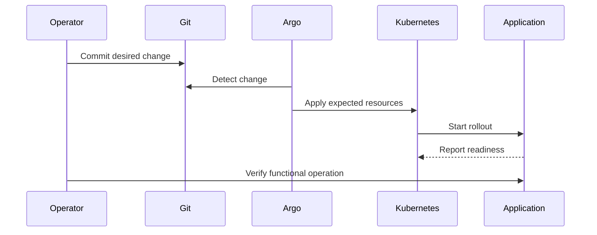

Detection, apply, rollout and functional recovery are different timestamps. A slow pull is not slow Git detection, and readiness is not the same as a successful research-data operation.

### Record separate measurements

- Fault/change introduced.
- Drift detected.
- Sync started.
- Expected revision and resource generation applied.
- Kubernetes observed the generation.
- Pods became Ready.
- Functional operation succeeded.
- Data consistency and reset were verified.

Synchronize clocks and record timezones; otherwise event ordering can be misleading.

### Freeze control variables

Record Git revision, effective image digests, ArgoCD/version/settings, HPA, Image Updater, probes, requests/limits, placement, dataset/checksums, backups, scheduled jobs and whether traffic traverses Cloudflare.

Do not overlap measurements with migrations, index rebuilds, unrelated repairs or uncontrolled image updates. Prefer a bounded experimental Application/namespace instead of production control-plane disruption.

The experiment needs a verified reset procedure, repetitions, defined success/failure criteria, observation windows and explicit safety/abort conditions. A single successful demonstration is not a reproducible result.

### Deployment verification is a current limitation

Issue #109 tracks verification that can pass before the expected merged revision/resources apply. Reliable proof must compare the intended revision and live object fields, wait for the corresponding rollout/hooks, and check functionality. A green workflow alone is not adequate experimental evidence.

## 18. Dated findings and remaining work

**These observations describe 20–21 October 2026, not the current cluster.**

| Area | Observation and limitation |
| --- | --- |
| Nodes | Three Ready, no reported memory/disk/PID pressure in the audit snapshot |
| Workloads | No unready workload in the audit snapshot; this is not a health guarantee |
| Metrics | The required scrape jobs were present and no active target was down in the 21 October read-only query |
| PostgreSQL | Native backups complete. Git declares a daily 02:00 `ScheduledBackup`; live `Backup` objects were observed hourly at HH:02 on 21 October. The cadence discrepancy was not explained and needs verification before relying on RPO. |
| Velero | Backup location Available. `weekly-infra-backup-20261018030030` was PartiallyFailed with 4 errors and 58 warnings; a later manual production Backup and the canary Backup completed. No successful actual weekly run was demonstrated. |
| OpenSearch | Single node, yellow, active primaries but unassigned replicas; no search HA |
| Redis | Approximately 272MiB used of 512MiB maxmemory; zero recorded evictions; `allkeys-lru` still risky for shared broker/session/cache |
| NFS | Approximately 25.3GiB available, 63% used at the 20 October snapshot; shared with every `btd-nfs` claim |
| Recent events | Cross-component probe/cache timeouts recovered; cause not established |
| Image Updater | No active image override (`imagesManaged: 0`) at the 21 October snapshot; an earlier restart is historical, not an active crash-loop claim |
| Retained storage | Earlier drill cleanup intentionally preserved Released/Retain PVs and backing directories; exact inventory is dated evidence, not a cleanup authorization |

### Issue interpretation at the audit

| Issue | Assessment |
| --- | --- |
| #104 | Scrape wiring is present and required jobs were observed; evidence supports closing it with the live target inventory. |
| #91 | The original zero-Backup/plugin-crashloop symptom is superseded by #139; the remaining weekly `PartiallyFailed` run is not a separate #91 root cause. |
| #109 | Active: deploy verification still samples a single all-green state, times out at five minutes, and is not hook- or revision-aware. |
| #139 | Partly completed: ownership, native DB restore, canary file restore and monitoring are verified. A private draft with a deterministic 64 KiB file is approved but its upload/save ID and seeded restore are pending; host/NFS evidence and independent DR also remain open. Split rather than close. |
| #140 | Initial Loki/Alloy restoration is verified; sustained natural-reconnect and authenticated Grafana query proof remain open. |
| #145 | Software/alert work and FIRING/RESOLVED delivery are verified; external IT restart-policy prevention is outside the repository. Close candidate for the software scope. |
| #161 | Vocabulary API/index repair is verified; owner browser confirmation and durable bulk-queue backlog handling remain open. Keep open and split the queue work. |
| #163 | This documentation change: README/guide alignment. Close only after the PR and required checks pass. |

Open issues are neither untouched failures nor all stale. They need evidence-backed reconciliation, not blanket closure. An assessment here is a dated snapshot; re-check the issue's own acceptance criteria before closing it.

### Readiness priorities

1. Complete canary metric/alert verification.
2. Seed a private draft with a known file and prove isolated recovery/reset.
3. Diagnose durable vocabulary bulk-queue progress.
4. Correct revision-aware deployment verification.
5. Define and approve the ArgoCD experiment protocol.
6. Measure a bounded representative baseline.
7. Execute only approved service faults, with verified recovery and reset.

Private draft/file recovery, published-record recovery and independent storage disaster recovery are different claims. Shared NFS/MinIO failure experiments remain excluded; host maintenance requires university coordination. SMTP remains a separate unavailable capability even though manually confirmed account login works.

## 19. Troubleshooting and glossary

### Follow the failing boundary

| Symptom | Start by inspecting |
| --- | --- |
| Git change not deployed | Application source/revision, rendering, sync operation and errors |
| Desired Deployment applied but Pods pending | Scheduling events, requests, affinity, PVCs and node capacity |
| Container fails to start | Image pull status, command, configuration and container logs |
| Pods Ready but operation fails | Actual API response, database/index state and task path |
| External URL fails, internal URL works | Cloudflare, tunnel, Traefik and hostname routing |
| Dropdown empty | Vocabulary API, source rows, index contents and indexing queue |
| Tasks accumulate | Queue routing, consumer subscriptions, failures and observed progress |
| Backup says Completed | Restore test and data consistency, not just status |
| ArgoCD unavailable, app still works | Expected separation of control and request paths |

Use read-only diagnostics first. Do not restart, purge, reindex globally or delete storage simply because a component looks suspicious; those actions can destroy evidence or data.

### Glossary

| Term | Meaning |
| --- | --- |
| Desired state | Declared configuration controllers should establish |
| Observed/live state | What currently exists in the cluster |
| Drift | Relevant difference between desired and live state |
| Reconciliation | Repeated work to bring observed state toward desired state |
| GitOps | Git-declared desired configuration continuously reconciled by software |
| Control plane | Components managing system state and coordination |
| Request/data path | Components an actual user operation traverses |
| Operator | Controller implementing application-specific lifecycle behavior |
| Derived data | Reconstructible representation, such as a search index |
| Idempotency | Repeating an operation has the intended equivalent effect |
| Failure domain | Shared dependency whose loss affects multiple components |
| RPO | Acceptable data loss measured in time |
| RTO | Acceptable time to restore required service |
| Reset | Return to a verified equivalent experimental baseline |

**Bottom line:** a valid ArgoCD experiment does not require pretending every layer is ArgoCD. It requires a known baseline, protected data, trustworthy measurements, explicit ownership and precise attribution of what each controller actually did.
