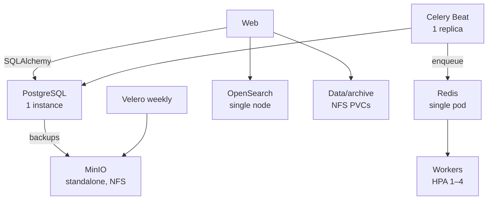

# Invenio deployment reliability review — #137

> **Date:** 2026-10-15 · **Baseline:** `76d6725605b33e8c3f65a5e553db916c4f62490e`
> **Scope:** repo-focused thesis baseline audit. No source/manifest/cluster
> changes, cluster queries, downloads, load tests, or secret decryption.

## Assessment

The repo describes a pilot, not an unqualified HA/recoverability baseline.
Confirmed gaps include an unsupported Python runtime, a nonfunctional checked-in
email-confirmation path, and a Velero stale-backup alert wired to a metric the
lead confirms is absent. Redis eviction and singleton scheduler rollout are
material reliability risks, not observed failures in this review.

Lead-supplied current state: all ArgoCD apps Healthy/Synced; scheduler limit
500m, average CPU about 1m, 29% throttled periods; PostgreSQL restarted
2026-10-14 01:38Z and the scheduler exited at 01:39Z with
`OperationalError: SSL connection closed`. These were not independently
queried; throttling is not established as the cause. Lead-owned etcd lease-loss
and node-exporter placement analysis is not duplicated here.

Database and Velero backups both land in in-cluster MinIO. This provides a
second copy, but not proven independence from cluster/NFS failure.

## Findings

### F1 — MEDIUM: unsupported Python runtime (confirmed)

- **Evidence:** `docker/ugm/Pipfile:16-17` requires Python 3.9; build uses it at
  `docker/ugm/Dockerfile:17-21`. Python 3.9 reached EOL 2025-10-31
  ([official status](https://devguide.python.org/versions/)). Base tag
  `almalinux:1` is mutable (`docker/ugm/Dockerfile:17`); deployed app digest is pinned
  (`k8s/apps/invenio/kustomization.yaml:21-23`).
- **Impact:** no upstream Python security updates; future rebuilds can vary.
- **Smallest remediation:** move to a supported Python compatible with the
  locked Invenio 13 dependencies and pin the base image by digest.
- **Verify:** build and run existing CI/functional checks; record an SBOM and
  vulnerability scan. No scan was run here.

### F2 — MEDIUM: Redis may evict Celery broker keys (risk, not observed)

- **Evidence:** one Redis replica uses `--maxmemory 512mb` and
  `--maxmemory-policy allkeys-lru` (`k8s/apps/invenio-deps/redis/manifests/redis.yaml:12-18,46-50`).
  Broker DB 0, result DB 2, sessions and caches share it
  (`k8s/apps/invenio/app-config.yaml:29-36`).
- **Impact:** at the cap, `allkeys-lru` can evict broker keys and lose queued
  work; this audit did not establish that the cap was reached.
- **Smallest remediation:** use `noeviction` for broker data or isolate it from
  evictable cache/session data; alert on memory headroom and rejected writes.
- **Verify:** confirm effective policy and expose memory/`evicted_keys`; send
  and consume a canary task while observing those signals.

### F3 — MEDIUM: Beat can overlap during rollout (configuration risk)

- **Evidence:** `k8s/apps/invenio/invenio-scheduler-deployment.yaml:13-23`
  sets one replica but no strategy, lease, or fencing; the only probe checks
  process presence (`k8s/apps/invenio/invenio-scheduler-deployment.yaml:83-91`). Kubernetes defaults Deployments to
  [`RollingUpdate`](https://kubernetes.io/docs/concepts/workloads/controllers/deployment/#updating-a-deployment),
  whose surge can start a second pod before the first exits.
- **Impact:** overlapping Beat instances may enqueue duplicate periodic work.
  `Recreate` avoids overlap but briefly interrupts scheduling.
- **Smallest remediation:** set `Recreate`; if overlap-free availability is
  required, use explicit leader election/fencing and idempotent tasks.
- **Verify:** non-production rollout proves old Beat exits before new Beat starts
  and no periodic task is emitted twice.

### F4 — MEDIUM: PostgreSQL restart terminated scheduler (observed incident)

- **Evidence:** lead-supplied event above. `docker/ugm/invenio.cfg:63-71`
  provides the DB URI but no explicit pool/reconnect options; scheduler liveness
  only checks process presence (`k8s/apps/invenio/invenio-scheduler-deployment.yaml:83-98`).
- **Impact:** scheduler stopped; whether work was delayed, skipped, caught up,
  or duplicated is unknown. The sequence does not prove missing
  `pool_pre_ping` is the root cause; dependency defaults were not traced.
- **Smallest remediation:** inspect locked SQLAlchemy/Invenio Jobs behavior and
  logs first; add only supported reconnect/retry handling shown to be missing.
- **Verify:** in non-production, restart PostgreSQL and check scheduler recovery,
  schedule lag, restart count, and task identity/idempotency.

### F5 — HIGH: recoverability is not proven (thesis DR gate)

- **Evidence:** CNPG has `instances: 1`, 10Gi `btd-nfs` storage, and MinIO
  backup destination (`k8s/apps/invenio-deps/postgresql/cluster.yaml:11-22,31-45`);
  retention is 30d and the comment describes daily backups (`k8s/apps/invenio-deps/postgresql/cluster.yaml:56-68`); the lead verified the live schedule actually runs hourly at minute 02. MinIO is standalone on
  `btd-nfs` (`k8s/infra/minio/values.yaml:9,26-30`). Velero's weekly, 28-day
  filesystem backup also targets that MinIO (`k8s/infra/velero/values.yaml:22-42`;
  `k8s/infra/velero/backup-schedule.yaml:10-26`). A 2026-09-05 assessment
  marked off-site copies and restore drills pending; current status is unknown
  (`docs/cluster-assessment-2026-09-05.md:108-116`).
- **Impact:** no PostgreSQL replica failover; shared cluster/NFS loss may affect
  primary and backup copies. Schedules do not prove a restorable backup.
- **Smallest remediation:** record accepted single-instance outage and RPO/RTO;
  establish an independent copy and complete an isolated restore drill.
- **Verify:** lead-owned current backup/storage checks, then record restored data
  checks and measured RPO/RTO from an approved canary restore.

### F6 — HIGH: Velero stale alert is blind to the live metric (confirmed)

- **Evidence:** `k8s/infra/monitoring/alerts.yaml:86-95` queries
  `velero_backup_timestamp`. Lead confirms that series is absent, the actual
  metric is `velero_backup_last_successful_timestamp`, there are zero Velero
  Backup CRs, and the last-success metric is from 2026-09-06.
- **Impact:** the configured stale-backup alert cannot report the confirmed
  backup gap. Full live diagnosis remains lead-owned.
- **Smallest remediation:** use the actual metric and alert on both stale
  success and missing metric/backup evidence.
- **Verify:** rule query returns the expected timestamp; stale/missing data fires
  an alert; a completed Backup CR and restore test prove recovery.

### F7 — MEDIUM: confirmation email is blocked by checked-in config (confirmed)

- **Evidence:** confirmation is required (`docker/ugm/invenio.cfg:206-214`);
  ConfigMap sets placeholder `smtp.example.org:587` with TLS
  (`k8s/apps/invenio/app-config.yaml:41-48`). Namespace egress defaults to deny
  (`k8s/infra/security/network-policies/invenio-netpol.yaml:8-15`) and the
  external allowance is TCP/443 only
  (`k8s/infra/security/network-policies/invenio-netpol.yaml:180-195`).
- **Impact:** new users cannot complete the configured confirmation flow.
- **Smallest remediation:** configure the approved relay and allow only its
  required SMTP egress.
- **Verify:** complete registration, receive the confirmation email, and redeem
  its token.

### F8 — MEDIUM: queue backlog and scheduler progress are unobserved

- **Evidence:** worker concurrency 2/prefetch 1
  (`k8s/apps/invenio/invenio-worker-deployment.yaml:67-77`); HPA uses CPU and
  memory only, max 4 (`k8s/apps/invenio/invenio-hpa.yaml:42-81`). Repo rules
  have no queue-depth/age or scheduler-lag signal; restart alerts require >5
  restarts/hour or a pod down for 15m (`k8s/infra/monitoring/alerts.yaml:60-72,205-218`).
- **Impact:** backlog can grow without an HPA signal; a quick scheduler restart
  or stalled Beat may go unnoticed. The supplied 29% throttled periods with
  ~1m average do not prove CPU starvation; throttled CPU time and schedule lag
  are unknown.
- **Smallest remediation:** expose queue depth/oldest age and scheduler
  heartbeat/dispatch lag; alert before considering queue-based scaling.
- **Verify:** observe those metrics and a canary task/schedule in non-production;
  compare queue-age alert behavior with HPA response.

## Coverage and baseline blockers

- **Probes:** web startup/readiness `/ping`, no dependency-coupled liveness
  (`k8s/apps/invenio/invenio-deployment.yaml:98-120`); worker Celery inspect
  probes (`k8s/apps/invenio/invenio-worker-deployment.yaml:95-130`); Beat
  process-only liveness
  (`k8s/apps/invenio/invenio-scheduler-deployment.yaml:83-91`). None prove scheduled-job progress.
- **Resources/ingress:** web HPA 2–4 and worker 1–4 at CPU 70%/memory 80%
  (`k8s/apps/invenio/invenio-hpa.yaml:13-40,54-81`); namespace quota 6 CPU/8Gi memory requests,
  with ~7.4Gi rollout-surge budget noted in
  `k8s/apps/invenio/namespace-governance.yaml:8-20`. Service 8000 maps to web 5000 and is
  allowed from Traefik (`k8s/apps/invenio/invenio-deployment.yaml:83-85,138-154`;
  `k8s/infra/security/network-policies/invenio-netpol.yaml:17-35`). Dependency egress allows DB 5432, Redis 6379,
  search 9200, MinIO 9000, DNS, HTTPS
  (`k8s/infra/security/network-policies/invenio-netpol.yaml:77-195`).
- **Dependencies:** lock pins InvenioRDM 13.0.9, Celery 5.4.0, Invenio Jobs
  4.4.1, SQLAlchemy 2.0.51, psycopg2-binary 2.9.12, Redis client 7.0.1, and
  Kombu 5.6.2 (`docker/ugm/Pipfile.lock`). App and Redis images are
  digest-pinned (`k8s/apps/invenio/kustomization.yaml:21-23`;
  `k8s/apps/invenio-deps/redis/manifests/redis.yaml:39-42`). No vulnerability
  scan was run.
- **Baseline gates:** accept single PostgreSQL/Redis/MinIO/OpenSearch failure
  domains or fund a separate HA design; prove an independent backup restore;
  upgrade/explicitly time-limit Python 3.9; fix Redis eviction and Beat rollout
  semantics; verify SMTP if registration is in scope.
- **Unknowns at static review:** live strategy/resource drift, scheduler restart count and missed
  work, Redis memory/eviction/queue depth, current off-site backups and restore
  status, SMTP reachability, and HPA quota headroom. Lead owns comprehensive
  live audit, including etcd/lease and node-exporter placement findings. Updated live observations are consolidated in `2026-10-15-baseline-stability-audit.md`.

## Verification

Static repository review only; package versions parsed from the lockfile. No
cluster commands, mutations, downloads, load tests, source fixes, or secret
decryption. Live Healthy/Synced status and metrics above are lead-supplied, not
independently certified. The lead independently reviewed the committed diff;
the consolidated audit records integration verification and remaining gaps.
