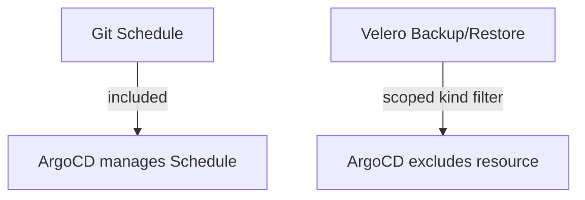

# Velero resource ownership safeguard (#139)

**Status:** deployed; ownership protection verified after #143. Backup recoverability remains open. **Scope:** ArgoCD and Velero
manifests, the Velero CI validator/tests, and this plan.

## Cause and design

ArgoCD v2.12.0 uses the default `app.kubernetes.io/instance` tracking label;
Velero-generated and storage-resynchronized Backup objects can retain the
`velero` value and be pruned as desired-state drift. Velero v1.17.1 can copy
Schedule labels to generated Backups when template labels are absent; its
storage resync recreates old metadata every minute, so template-only changes are
not retroactive.

Add one exact `resource.exclusions` rule for `velero.io` `Backup` and `Restore`
on the Velero app's `https://kubernetes.default.svc` cluster. ArgoCD v2.12
also uses the internal REST alias `https://10.43.0.1:443`; #143 adds that explicit alias after live verification found the initial rule insufficient. ArgoCD v2.12
documents exclusions as removing matching kinds from discovery and sync,
preventing ArgoCD from adopting/pruning them without changing tracking or
global prune settings. The validator allows unrelated rules only with explicit,
non-wildcard API groups and kinds; it rejects extra Velero Backup/Restore or
Schedule exclusions. The Git-managed `Schedule` remains included.
See [ArgoCD v2.12 resource exclusions](https://argo-cd.readthedocs.io/en/release-2.12/operator-manual/declarative-setup/#resource-exclusioninclusion).

ArgoCD retains Git ownership of the Schedule while Velero-generated Backup and
Restore resources stay outside ArgoCD discovery and sync.

## Tests and local verification

- TDD: regression tests failed for the missing rule and overly broad scope
  before their respective fixes. Six tests now cover local-cluster scope,
  unrelated narrow exclusions, wildcard rejection, Argo ConfigMap identity,
  and Schedule presence/visibility.
- `python3 scripts/tests/test_ci_validate_velero.py` — 6 tests passed.
- `python3 scripts/ci-validate-velero.py` — passed.
- `yamllint` on the changed YAML and `kustomize build k8s/infra/velero` — passed.
- Offline Kustomize patch render against a local `argocd-cm` base confirmed the
  rendered ConfigMap contains the exclusion. Full ArgoCD render was not run:
  its v2.12.0 base is not cached and fetching it is outside the approved scope.
  The shared CI workflow invocation is owned by the lead.

## Live verification

Deployment was explicitly approved and verified after the endpoint correction in #143; see `2026-10-15-runtime-selection.md` for the timestamped evidence. The repeatable check is to
sync, confirm `argocd-cm` contains the exact exclusion, `argocd app resources
velero` still lists `Schedule/weekly-infra-backup` but no Backup/Restore, the
Velero Backup objects remain available, and controller logs show no new
Backup/Restore `Pruned` events. Use read-only inspection only; do not launch
backup or restore jobs.

## Rollback

Do not remove the exclusion alone while Velero auto-prune/self-heal and default
label tracking remain enabled; that reopens the deletion path. Keep the
exclusion until an equally scoped replacement protection is verified. Then
revert the ConfigMap change if required; the Schedule remains Git-managed.

## Separate compatibility risk

The AWS plugin v1.11.1 is listed as compatible with Velero v1.15.x, while the
official matrix pairs Velero v1.17.x with plugin v1.13.x. Track this separately;
no Velero/plugin upgrade is included. See the [plugin compatibility matrix](https://github.com/vmware-tanzu/velero-plugin-for-aws/blob/v1.11.1/README.md#compatibility).
