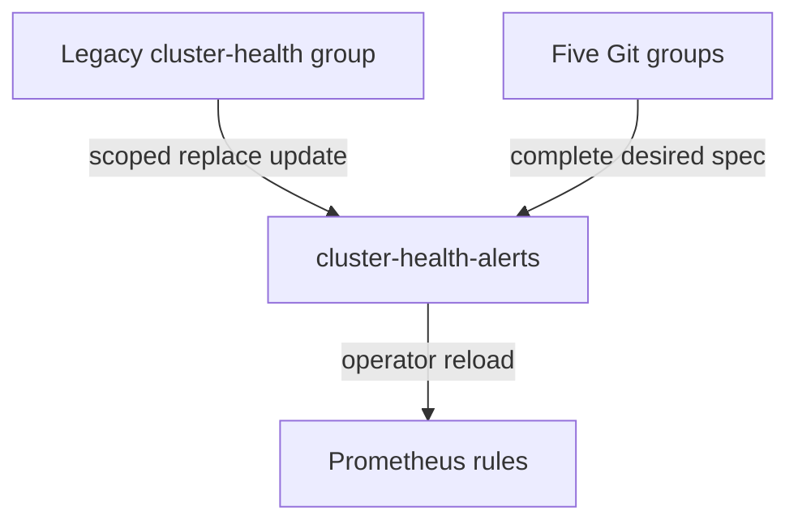

# Alert Truthfulness Implementation Plan

> **For agentic workers:** Use `executing-plans` in this session. No delegation. Steps use checkbox syntax.

**Goal:** Keep desired alert rules truthful, remove the obsolete live rule group through a resource-scoped reconciliation, and render useful Discord messages.

**Architecture:** Keep the existing `PrometheusRule/cluster-health-alerts` identity and release label. Add a phase-filtered `PodNotReady` rule, base crash-loop detection on kube-state-metrics' `CrashLoopBackOff` waiting reason, and scope `Replace=true` to this CR only because Argo CD 2.12 SSA does not migrate the legacy client-side owner. Render Discord templates from parsed YAML with native `amtool`.

**Tech Stack:** PrometheusRule, `promtool test rules`, PyYAML, Alertmanager `amtool`, Argo CD 2.12.

## Constraints

- Work only in `k8s/infra/monitoring/`, `scripts/ci-validate-monitoring.sh`, dedicated monitoring alert/template tests, this plan, and uncommitted `WORKER-REPORT.md`.
- Do not edit shared CI/workflow files or the plans index.
- No cluster writes, host changes, secrets, SSH, downloads, installs, pushes, PRs, or merges.
- No probe/resource tuning; the confirmed RKE2 restart cause requires IT coordination.
- No `Force`, resource deletion, global apply policy, or duplicate legacy rules.
- Preserve the `release: monitoring` label and desired alert coverage.
- Commit only scoped files with a Conventional Commit referencing #145; leave `WORKER-REPORT.md` uncommitted.

## Files

- `k8s/infra/monitoring/alerts.yaml`: scoped Replace annotation and accurate pod alerts.
- `k8s/infra/monitoring/discord-receivers.yaml`: actual multiline message templates with useful fallbacks.
- `k8s/infra/monitoring/tests/health-alerts.test.yaml`: succeeded, unready, and CrashLoopBackOff cases.
- `scripts/tests/test_monitoring_alerts.py`: exact group/rule contract and native Discord rendering checks.
- `scripts/ci-validate-monitoring.sh`: run all monitoring rule tests and the dedicated alert/template tests.
- `docs/plans/active/2026-10-16-alert-truth.md`: decisions and verification record.

## Execution

- [x] Add Prometheus regression cases and alert/template tests; run against current YAML and confirm the expected failures.
- [x] Correct the pod alert expressions and Discord templates; add only the scoped Replace annotation.
- [x] Wire the tests into the existing monitoring validator without editing shared workflows.
- [x] Run Prometheus tests, native template renders, monitoring validator, YAML/shell checks, Kustomize render, and scoped diff review.
- [x] Commit the assigned files and leave the required worker report uncommitted.

## Reconciliation Decision

The pinned Prometheus Operator v0.82 CRD declares `spec.groups` as an associative list keyed by group `name`; `groups[].rules` is an atomic list. Argo CD 2.12.0's sync path supports SSA but does not expose the later client-side apply migration option. Therefore the legacy `cluster-health` group can remain owned by `kubectl-client-side-apply` while Argo owns its desired groups. Resource-level `Replace=true` uses the `kubectl replace` update path for this single `PrometheusRule`, with no `Force`; the annotation remains scoped and the live result must be checked after an approved deployment.

The update replaces only this `PrometheusRule` with its Git-declared spec; other monitoring resources and the CRD remain untouched. Prometheus reloads the resulting rules without a pod restart.

## Acceptance

- Exact five-group Git rule contract rejects the extra `cluster-health` group and legacy rules.
- Succeeded pods do not trigger `PodNotReady`; a sustained genuinely unready pod does.
- `CrashLoopBackOff` alerts with pod phase `Running`, while unrelated restart counts do not.
- Discord renders real line breaks, separates grouped alerts, uses alert-name/description fallbacks, and omits unavailable optional links.
- `WORKER-REPORT.md` records commit SHA, files, exact local checks, live verification steps, and deployment gap.
