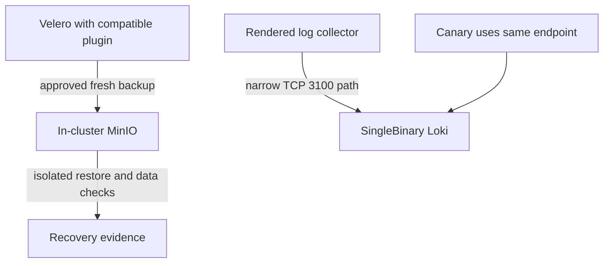

# Backup/Restore and Central Logging Review (#145)

**Status:** Read-only assessment; no remediation or backup/restore operation performed.
**Snapshot:** Kubernetes context `btd`, 2026-10-16 01:01 UTC; repository base `a79b4fc`.
**Verdict:** Current Velero recovery is unproven, and the live Loki release has neither a log backend nor an active collector.

## Findings

### P1 — Velero recovery is unproven (confirmed)

- At the snapshot, `kubectl get backups.velero.io -A` showed two old resources,
  both `PartiallyFailed`: `weekly-infra-backup-20260814141943` and
  `weekly-infra-backup-20260830030015` (start times Aug 14 and Aug 30; neither
  has a completion timestamp). `kubectl get backups.velero.io,restores.velero.io
  -A -o wide` returned no Restore objects. This is not evidence that a restore
  was never tested outside this cluster.
- The schedule is `Enabled`, with last run `2026-10-11T03:00:20Z`; scheduling
  activity is not successful-backup or restore proof. The latest recorded
  `velero_backup_last_successful_timestamp` is 2026-09-06 (about 39 days old at
  the 2026-10-15 15:44 UTC check); see
  [`2026-10-15-runtime-selection.md`](2026-10-15-runtime-selection.md#live-evidence-2026-10-15-approximately-1544-utc).
- The repo pins AWS plugin `v1.11.1` while the installed Velero line is `v1.17.x`;
  the recorded compatibility matrix pairs plugin `v1.13.x` with Velero `v1.17.x`
  ([values](../../../k8s/infra/velero/values.yaml#L44-L48),
  [compatibility note](2026-10-15-velero-ownership.md#separate-compatibility-risk)).
  This is a confirmed compatibility gap, **not a proven cause** of the failed or
  stale backups. Current configuration writes to in-cluster MinIO, not an
  independent off-site destination ([Velero values](../../../k8s/infra/velero/values.yaml#L33-L42)).
- **Smallest safe recovery scope:** separately review and select a plugin version
  supported for Velero 1.17.x; after explicit approval, make that narrow change,
  run one fresh backup, inspect its Backup and all relevant volume-backup
  outcomes, then perform an isolated restore and verify restored data and
  measured RPO/RTO. A `Completed` Job or `Available` BackupStorageLocation alone
  is not backup proof; a completed backup without an isolated restore is not
  recovery proof. Keep off-site storage as a distinct owner decision because
  current MinIO shares the cluster failure domain.

### P2 — Loki has no functioning ingestion/query path (confirmed live)

- The pinned Loki chart is `6.24.0` (`argocd/apps/loki.yaml:11-16`); its default
  `deploymentMode` is `SimpleScalable`, but
  [`values.yaml`](../../../k8s/infra/loki/values.yaml#L22-L23) omits the mode,
  sets `singleBinary.replicas: 1`, and sets `read`, `write`, and `backend`
  replicas to zero; gateway is disabled (`loki/values.yaml:74-82`). The live
  inventory contains only Loki canaries and cache StatefulSets—no Loki server,
  gateway, or Loki API/backend Service. ArgoCD reports the app
  `Synced/Healthy`, which does not establish that the log path works.
- The same cluster-wide inventory found no Promtail/Alloy/Fluent Bit/Vector pod
  or DaemonSet. Although values say `promtail.enabled: true` and configure a
  client URL to `loki.monitoring.svc:3100` (`loki/values.yaml:109-131`), the
  collector is absent; a values entry is not proof that chart 6.24 renders or
  deploys it.
  Canary logs at the snapshot repeatedly report DNS lookup failure for
  `loki-gateway.monitoring.svc.cluster.local.:80` (`kubectl -n monitoring logs
  loki-canary-fzd9d --tail=20`). This is consistent with the absent gateway
  Service, not evidence of a DNS outage.
- **NetworkPolicy:** `loki-allow-internal` admits same-namespace ingress to
  Loki-labeled pods on TCP/3100 and allows their egress only to DNS
  (`k8s/infra/monitoring/loki-networkpolicy.yaml:7-33`). Monitoring's general
  egress policy allows TCP/80, TCP/443, and DNS, not collector-to-Loki TCP/3100
  (`k8s/infra/security/monitoring-egress.yaml:23-62`). Keep backend ingress
  narrow and add/verify only the collector-to-backend egress needed by the
  rendered labels and endpoint; do not open general cluster egress.
- **Retention/storage:** values select filesystem storage under `/loki/storage`
  and a 10Gi `btd-nfs` PVC for SingleBinary (`loki/values.yaml:4-8,22-34`), but
  no Loki PVC exists live and values specify no Loki retention period or
  compactor retention. Prometheus's 7-day retention (`monitoring/values.yaml:19`)
  is unrelated. Define the log-retention target and validate its rendered
  compactor/storage configuration before claiming bounded retention.
- **Capacity is not approved by this snapshot:** monitoring quota usage was
  12/50 pods, 1850m/6 CPU requests, and 2304Mi/6Gi memory requests. `kubectl top
  nodes` showed memory use of 53% (server), 59% (worker-01), and 72% (worker-02).
  This point-in-time usage omits the missing backend and does not prove node or
  shared-NFS headroom for a rollout or retention growth. Render requested
  resources/PVC first and confirm current node allocatable and NFS capacity.
- **Smallest safe Loki scope:** keep the apparent intended single-node design;
  explicitly select `SingleBinary`, then render the pinned chart and prove a
  server Service, persistent claim, and a real collector are produced. Use one
  working endpoint for collector and canary, add only the narrow TCP/3100 egress
  if required, and set an explicit retention policy. Do not introduce a
  distributed Loki stack or object store without measured need and an owner
  decision. SingleBinary plus in-cluster NFS remains a single failure domain,
  not HA or off-site log retention.

The minimum intended paths are shown below. Backup verification must end in an
isolated restore; log ingestion requires a rendered collector, reachable Loki
endpoint, and a deliberate retention bound.

## Priority, gates, and boundaries

1. **Recovery first:** scope plugin compatibility and a fresh-backup/isolated-
   restore proof as a dedicated approved operation. Decide separately whether
   same-cluster MinIO meets recovery objectives or an independent destination is
   required.
2. **Logging next:** make the pinned chart render explicitly for SingleBinary
   and prove collector, endpoint, network-policy path, retention, resource
   requests, and PVC before any deployment.
3. Future backup work needs explicit approval for plugin image pull/deployment
   and for creating a backup and isolated restore. Off-site storage additionally
   needs an owner/provider decision and credentials provisioned through the
   approved secret process; this worker did not read secrets.
4. Future Loki work needs explicit deployment approval, a retention/NFS-capacity
   decision, and the pinned chart package available for render. If it is not
   already cached, chart retrieval requires download approval; do not
   download/install without that approval.
5. Lead-owned host incident is separate: the lead reports unattended-upgrades
   dpkg logs explicitly restarting `rke2-agent` four times around 06:46–06:52
   local on Oct 16, matching NodeNotReady/CSI failures. This review did not
   investigate or propose host-policy changes.

## Evidence and limits

- Read-only commands on context `btd`:
  - `kubectl config current-context`
  - `kubectl -n monitoring get pods,svc,ds,deploy,statefulset -o wide`
  - `kubectl get pods,daemonsets -A -o wide | grep -Ei '(^NAMESPACE|promtail|alloy|fluent|vector|loki)'`
  - `kubectl -n monitoring get networkpolicy loki-allow-internal -o yaml`
  - `kubectl -n monitoring get pvc`; `kubectl -n monitoring get resourcequota,limitrange`; `kubectl top nodes`
  - `kubectl -n argocd get applications.argoproj.io loki -o wide`
  - `kubectl -n monitoring logs loki-canary-fzd9d --tail=20`
  - `kubectl get backups.velero.io,restores.velero.io -A -o wide`
  - `kubectl get backups.velero.io -A -o custom-columns=NAMESPACE:.metadata.namespace,NAME:.metadata.name,PHASE:.status.phase,START:.status.startTimestamp,COMPLETION:.status.completionTimestamp`
  - `kubectl -n velero get schedules.velero.io -o custom-columns=NAME:.metadata.name,PHASE:.status.phase,LAST:.status.lastBackup,NEXT:.status.nextBackup`
- No Helm render was performed (no chart download/install); collector/chart rendering, current NFS free capacity, and current Prometheus metric were not independently re-queried. Metric age and compatibility evidence are from the timestamped Oct 15 records above. No secrets, SSH, backup/restore jobs, restarts, or cluster writes were used.
