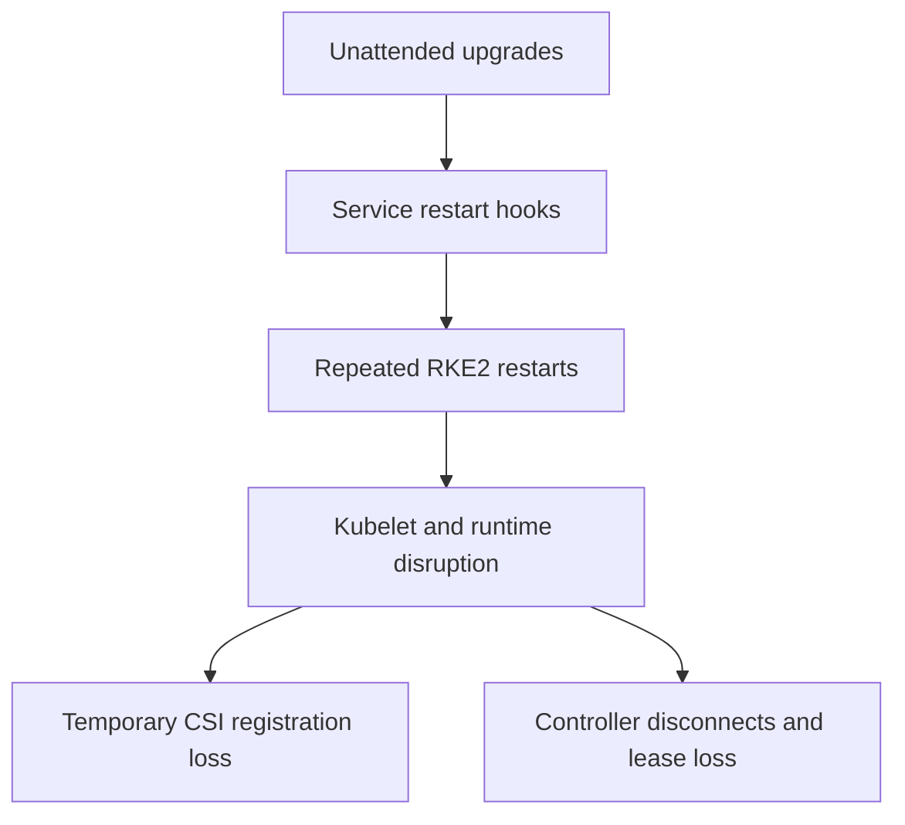

# Worker-02 Incident and Alert Correctness Implementation Plan

> **For agentic workers:** Use `executing-plans`; delegated work uses herd with isolated worktrees.

**Goal:** Diagnose the worker-02 disruption, repair misleading incident notifications, and assess outstanding recovery/logging blockers.

**Architecture:** The lead owns live host/runtime evidence. One worker prepares tested alert/ownership/template repairs; the second performs a bounded read-only recovery review. Deployment and stateful recovery jobs require separate approval.

**Tech Stack:** RKE2, NFS CSI, CloudNativePG, ArgoCD 2.12, Prometheus/Alertmanager, Velero, Loki.

## Constraints

- Issue #145; two workers approved on 2026-10-16. Base `a79b4fc`.
- Preserve operator edits in the original `.opencode/agents/` files.
- No cluster mutations, restarts, host changes, secret access, downloads, backup/restore jobs or destructive cleanup.
- Diagnose before changing resources/probes; do not silence real failures.
- Tests must cover desired rule presence AND absence of unmanaged legacy definitions.
- Infrastructure configuration is exempt from application TDD, but its regressions must fail before the fix; maintained helper/test code follows TDD.

## Ownership

| Owner | Scope |
|---|---|
| Lead | This incident record, plans index, shared CI integration, live worker/runtime diagnosis |
| alert-truth | `k8s/infra/monitoring/`, monitoring validation/template scripts and dedicated tests, `docs/plans/active/2026-10-16-alert-truth.md` |
| recovery-review | Only `docs/plans/active/2026-10-16-recovery-logging-review.md`; read-only repo/cluster assessment |

Workers must not edit shared CI or the plans index; scratch reports remain uncommitted.

## Work

- [x] Capture current pod status, previous logs, warning events and metrics; both alerted controllers recovered.
- [x] Reproduce false NotReady notifications for Succeeded pods and identify four live legacy rules absent from Git.
- [x] Fetch main into isolated worktrees; baseline eight script tests and 24-rule monitoring validation pass.
- [x] Dispatch bounded workers; designs and final regression evidence remain pending.
- [x] Correlate worker-02 events and controller exits with host maintenance logs; an IT evidence packet follows below.
- [ ] Review safe ownership reconciliation, completed-pod exclusion, genuine crash/readiness coverage and actual Discord newline rendering.
- [ ] Independently test, lint, render and review changes; run CI; ask before deployment.
- [ ] After approval, verify exact live custom-rule set, alert truthfulness, message rendering and service health. No baseline certification before remaining blockers are resolved or explicitly accepted.

## Initial Evidence (UTC; local time UTC+7)

- Worker-02 NotReady: 2026-10-15 23:47:15Z. Kubelet Starting events: 23:47:43, 23:48:37, 23:50:10, 23:51:46. Transient image-filesystem capacity 0 and CSI registration/mount errors followed. These do not prove a full disk.
- CSI provisioner exited at 23:58:55Z after losing `unix:///csi/csi.sock`; recovered at 23:59:17Z. CNPG operator exited at 00:01:02Z after API lease renewal failed; ready at 00:01:36Z.
- At approximately 00:42Z, both controllers Ready, NFS driver registered, PostgreSQL healthy with backup completed 00:02:48Z, public `/ping` HTTP 200. PodCrashLooping was not currently firing; no restart or silence was performed.
- Worker-02 sampled two-minute iowait peaked at approximately 60.8% over the preceding two hours. Boot-time metric remains February; kubelet/runtime restart is established but a VM reboot is not.
- Etcd's bounded two-hour sample contains eight slow-apply warnings, including approximately 579ms near the incident, but no slow-fdatasync warning. Do not assume the prior master-storage fault recurred.
- Live `cluster-health-alerts` contains legacy `cluster-health` group absent from Git: `PodCrashLooping`, `PodNotReady`, `HighMemoryUsage`, `NodeDiskPressure`. Historical client-side ownership remains alongside ArgoCD server-side ownership. The former alerts on any restart rate, the latter on every non-Running phase including Succeeded. Exact SSA field ownership/migration needs verification.
- Native Discord message fields contain literal backslash-n in single-quoted YAML and no useful fallback for missing annotations. This explains empty/literal-newline spam, not the underlying host incident.

## Acceptance and rollback

Keep healthy completed pods quiet while retaining genuine Pending/Unknown/unready and persistent crash coverage. Reconcile only the owned custom rule resource, not all ArgoCD resources. A safe rollback must not silently reintroduce obsolete alerts. Preserve timestamped incident evidence and distinguish application recovery from root-cause resolution; no experiment-ready claim while worker-02 and backup/restore/logging gaps remain.

## Confirmed Trigger: Automatic Host Maintenance

Authorized read-only `/api/v1/nodes/ubuntu-btd-kubernetes-worker-02/proxy/logs/` access exposed standard host log files without SSH. A short-lived localhost-only `kubectl proxy --append-server-path` preserved Rancher API authentication; it was terminated after each bounded read. HTTP Range reads were capped at 64–512KiB and unbounded transfers refused. No auth/private logs, credentials or host configuration were read or changed. The kernel-log request returned HTTP 500; no retries or broad log transfer were performed.

`unattended-upgrades.log` records an automatic run at 06:41:36 local on Oct16. APT history records systemd/udev upgrades 06:42:29–06:45:59, curl 06:47:49–06:48:10, OpenSSH 06:48:56–06:49:47 and bind libraries 06:50:31–06:50:52.

`unattended-upgrades-dpkg.log` explicitly invokes `systemctl restart rke2-agent.service` in four batches:

| Local UTC+7 batch | UTC batch | Observation |
|---|---|---|
| 06:42:24–06:47:45 | Oct15 23:42:24–23:47:45 | Restarts RKE2 alongside several host services |
| 06:47:47–06:48:42 | Oct15 23:47:47–23:48:42 | Restarts RKE2 again |
| 06:48:44–06:50:27 | Oct15 23:48:44–23:50:27 | Restarts RKE2 again |
| 06:50:30–06:52:30 | Oct15 23:50:30–23:52:30 | Restarts RKE2 again |

Syslog records `Stopping rke2-agent.service` at 06:46:26, killed kubelet/containerd at 06:46:29, and agent up at 06:51:57 after repeated starts. Remaining containerd-shim processes are noted during stop/start; this is not proof that every workload container restarted or that they should be killed manually. The VM boot metric does not change.

The package-maintenance logs establish the restart trigger; node events and container logs establish the downstream incident. I/O pressure may aggravate recovery but is not needed to explain who initiated these service restarts. It does not prove every historical failure had this cause.

## University IT Message

> We traced this morning's worker-02 disruption to unattended package maintenance. On 16 October, roughly 06:46–06:52 local time (UTC+7), `/var/log/unattended-upgrades/unattended-upgrades-dpkg.log` explicitly invokes `systemctl restart rke2-agent.service` in four successive batches. Syslog and Kubernetes events show matching kubelet/runtime restarts, NodeNotReady and CSI registration failures. Both controllers have recovered, but this policy can interrupt workloads again. Could you keep security patching enabled while deferring automatic RKE2 agent/server restarts to a coordinated, staged maintenance window? Please review the appropriate needrestart policy and other scheduled restart automation on all cluster nodes; do not disable updates globally. We have not changed any host settings. Since PostgreSQL and several dependencies are single-instance, any drain/restart needs an agreed outage/recovery plan and backup checks first.

Host policy is an administrator-owned action, not something a GitOps manifest or quieter alert can repair. Confirm the chosen policy and observe the next maintenance cycle before claiming recurrence prevention.
