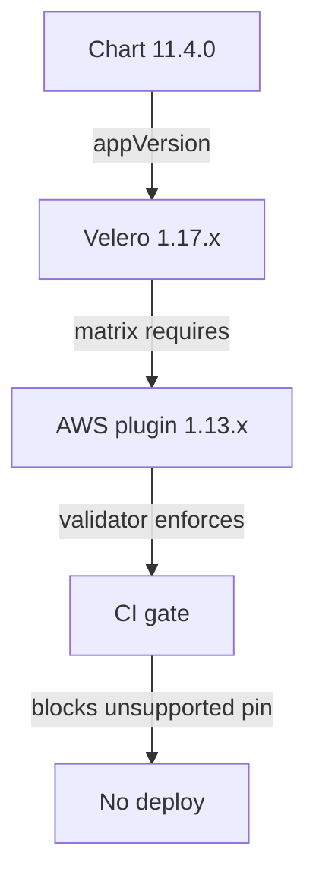

# Velero backup failure diagnosis and plugin compatibility repair (#139)

**Status:** Diagnosis incomplete — live cluster access timed out. Prepared repair is
committed but not deployed. **Scope:** Velero values, Velero CI validator and its
tests, this plan. Restore procedure is owned separately.

## Confirmed from repository evidence

- `argocd/apps/velero.yaml` pins Helm chart `11.4.0`; that chart's `Chart.yaml`
  declares `appVersion: 1.17.1`, so the running Velero server line is 1.17.x.
- `k8s/infra/velero/values.yaml` pinned the AWS plugin at `v1.11.1`. The official
  plugin compatibility matrix pairs `v1.11.x` with Velero `v1.15.x` and
  `v1.13.x` with Velero `v1.17.x`
  ([matrix](https://github.com/velero-io/velero-plugin-for-aws/blob/v1.13.2/README.md#compatibility)).
  The pin is therefore an unsupported pair. This is a confirmed compatibility
  gap, not a proven cause of the four errors in the latest backup.
- The image `velero/velero-plugin-for-aws:v1.13.2` exists in the registry
  (multi-arch manifest resolves) and is not present in the local Docker image
  cache. Node-level cache state could not be checked without cluster access.

## Live evidence still missing

Kubernetes API requests to context `btd` failed with a 10-second
connection/header timeout. The following were therefore **not** observed for
this review:

- the four error and 58 warning messages of the latest (2026-10-18)
  `PartiallyFailed` backup;
- `PodVolumeBackup` phase counts and the per-volume failure causes;
- the running plugin image and whether the server logged plugin restarts;
- whether every namespace in `backup-schedule.yaml` exists in the cluster.

No repair of the backup content, schedule scope, or object-store data was made.
The four errors must be attributed from the backup's error/warning files or
`kubectl -n velero get podvolumebackups` before any change that alters data
coverage.

## Prepared repair

Pin the AWS plugin to the supported 1.17.x pair (`v1.13.2`) and gate that pairing
in CI so a chart or plugin bump cannot silently recreate the mismatch.

The validator maps chart version to Velero series and requires the plugin tag to
match the supported series; unknown chart versions fail closed until the mapping
is updated deliberately.

## Tests

Regression tests were written first and failed on the current pin
(`Velero 1.17.x requires AWS plugin 1.13.x, found v1.11.1`). Current results:

- `python3 scripts/tests/test_ci_validate_velero.py` — 9 tests passed.
- `python3 scripts/ci-validate-velero.py` — passed.
- `python3 -m unittest discover -s scripts/tests` — 14 tests passed.
- `yamllint k8s/infra/velero/values.yaml` and
  `kustomize build k8s/infra/velero` — passed.

## Deployment gate and remaining decisions

1. **Image pull:** deployment requires pulling
   `velero/velero-plugin-for-aws:v1.13.2` on the cluster. If the nodes cannot
   reach the registry, a pre-pull must be approved first; no download was
   performed here.
2. **Root cause:** the plugin mismatch alone does not explain the four errors.
   The lead's live evidence (backup error/warning files, `PodVolumeBackup`
   phases, plugin restart logs) must be attached before declaring the cause or
   changing backup scope.
3. **Data coverage:** no schedule or namespace-scope change is proposed. Any
   change to what is backed up requires an explicit owner decision and preserved
   existing backup objects.
4. **MinIO SDK behaviour:** plugin 1.13.x uses `aws-sdk-go-v2`; MinIO is not in
   the upstream known-issue list, but post-deploy verification must confirm the
   BackupStorageLocation stays `Available` and a fresh backup writes objects.
   No speculative `checksumAlgorithm` override was added.
5. **Restore proof:** a completed backup is not recovery proof. An isolated
   restore drill remains separately owned and gated.

## Rollback

Revert the plugin tag to the previous pin only if the supported pair fails live;
CI will then fail the compatibility check by design, so record the exception in
this plan rather than bypassing the gate.
