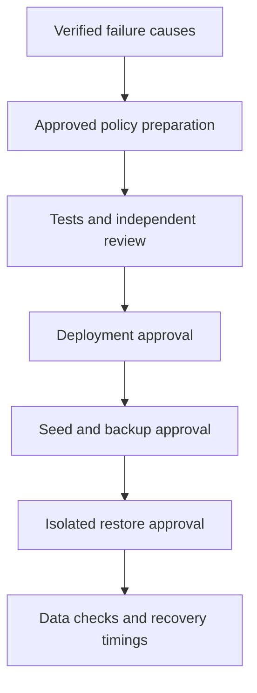

# Batch 1 recovery evidence and gates (#139)

## Status

Two workers authorized for investigation and tested repair preparation. No deployment,
backup/restore job, seed creation, secret access or object deletion authorized.
User subsequently approved preparing targeted volume coverage; this is not deployment
approval. Preserve all existing Backup objects and stored data.

## Verified findings

- Oct18 Backup `weekly-infra-backup-20261018030030`: PartiallyFailed, four errors,
  58 warnings. Two worker `tmp` PVBs rejected by admission: limits.cpu used2/hard2.
- MinIO `export` and Prometheus TSDB PVBs failed. Lead independently queried historical
  `kube_pod_container_status_terminated_reason` for mover suffixes `jwpvw`/`tdsz6`:
  both OOMKilled=1. Worker correlated 256Mi limits with namespace defaults.
- Idle quota usage does not establish historical concurrency; do not infer a safe
  budget by dividing current usage. Include maintenance jobs and prepared movers.
- Broad filesystem backup includes temporary directories and its own MinIO destination.
- Live Velero1.17.1/AWSplugin1.11.1 mismatch is a separate compatibility risk, not the
  established cause of the four failures. Prepared supported pin is plugin1.13.2.
- Web Deployment mounts verified; Invenio data/archive each4KiB, zero files. A completed
  empty-volume restore cannot establish meaningful file recovery.
- CNPG backup/archiving are distinct from raw live-pgdata copies. Native database
  restore plus file/DB consistency must be tested separately.

## Approved preparation scope

Keep Kubernetes metadata coverage; select useful volume data explicitly: Invenio
data/archive, Grafana persistent state and Redis broker/session data. Do not classify
Redis as disposable cache. Stop temporary-volume and MinIO self-backup. Database
recovery uses native CNPG; search indexes require a validated rebuild path.
Neither exclusion nor successful local backup provides independent MinIO/NFS recovery.
Data-mover resource/concurrency wiring needs version-matched render/tests and a quota
budget; no blind quota increase. Annotation changes may roll application/Redis/Grafana
pods and must be disclosed before deployment.

Each arrow has a verification gate; the first successful status is not the finish.
The current authorization ends before deployment and before creating test data.

## Impact on remaining batches

| Batch | Updated requirement |
|---|---|
| Scheduler | Shared resource pressure and Redis task replay must be considered; drill must never dispatch production jobs. |
| Logging | Use bounded retention; distinguish operational log history from protected app data; do not add recursive backup-store coverage. |
| Deployment safeguards | Validate exact volume allowlist, native-recovery prerequisites and resource/config wiring; restore must preserve production PVs and never run restored app hooks. |
| Baseline | Require seeded file checksum, native DB recovery, file/DB consistency strategy and measured RPO/RTO; record shared-NFS disaster-recovery gap. |

## Remaining gates

- Supported plugin image not locally cached: no image pull/download performed; user
  must handle/confirm required download before deployment under standing policy.
- Re-measure NFS capacity and node/quota headroom before any drill; NFS capacity is
  shared, nominal PVC sizes are not independent free-space guarantees.
- Velero1.17 FSB restore is Pod/PVR driven: restoring PVC metadata alone is insufficient.
  Restore design must sanitize the associated Pod to a verifier, disable app execution,
  remove production credentials/egress and validate resource modifiers before approval.
- Native CNPG recovery needs separately provisioned drill credentials and isolation
  before creating its Cluster; operators can create Services automatically.
- Deployment PR, CI, post-merge Deploy Verify and exact live coverage verification are
  required before requesting seed/backup/restore execution. Recovery remains unproven.
