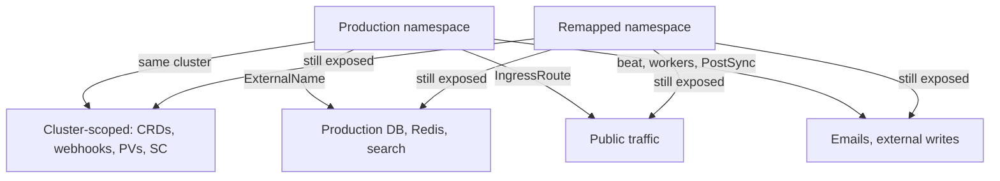

# Restore contract and isolated drill design (#139)

**Status:** design and coverage review only; no backup, restore, mutation or data
creation. **Snapshot:** `32c86c5`, 2026-10-19, live `btd` (read-only). This
worker owns this file; the lead owns the index and Velero manifests/tests.
Nothing here certifies recovery.

## Live evidence

- BSL `default` **Available** (`velero-backups`); Schedule `Enabled`, last
  `2026-10-18T03:00:30Z`; Velero `v1.17.1`, AWS plugin `v1.11.1`.
- Four Backups, **all `PartiallyFailed`** — 08-14 (1 err), 08-30 (23), 09-20
  (25), 10-18 (4 err, 58 warn, 3458 items). No Restores exist.
- Latest: 46 PVBs, 42 `Completed`, 4 `Failed` — MinIO `export` (771 MB) and
  Prometheus TSDB (106 MB) data movers were **OOMKilled at the 256Mi LimitRange
  default**, and two `invenio` volumes were rejected by `velero-quota`
  (`limits.cpu` 2/2 at 250m); quota after 750m/2 CPU, 3/10 pods.
  `defaultVolumesToFsBackup: true` also copies emptyDir `tmp`/config, hence named
  PVCs and anonymous volumes side by side in `invenio`.
- CNPG: `Ready`, `ContinuousArchiving`, `LastBackupSucceeded` True; hourly barman
  backups through 07:02Z.
- PVCs all `btd-nfs`, `Retain`: app data 20Gi RWX ×2, `postgres-3` 10Gi, `minio`
  20Gi, plus monitoring/redis/search; three Released PVs. MinIO mount 26G free
  of 69G (shared, not per-PVC). Node memory 51/56/67%.

## Findings

- **A `Completed` `postgres-3` PVB is not recovery proof.** It is a kopia copy
  (649 MB) of a live data directory: at best crash-consistent, possibly torn,
  WAL state not matching the barman chain. Never mount it or bootstrap CNPG from
  it; the barman/WAL chain is the only DB authority.
- **Files vs database skew:** app files are copied independently of the DB
  backup, so a restore can pair files with metadata from another instant.
- **Self-backup:** CNPG and Velero share one MinIO on the same NFS and the
  schedule includes `minio`; restoring MinIO from a backup stored in MinIO is
  circular if that PVC is lost. `kube-system` (cloudflared, sealed-secrets) is
  absent, `cert-manager` has no ArgoCD app, and no cluster-scoped object is
  covered.
- **Data content is unproven (baseline gap):** mounts verified live —
  `data`→`/opt/invenio/var/instance/data`, `archive`→`.../archive` — are the
  PVCs, not container-local paths. Both report 4 KiB and **zero files**, and
  their PVBs have empty progress: consistent with genuinely empty volumes, not
  to be read as a failed copy or as success. **Prerequisite for any content
  proof:** a known seed — one record with one attached file, recorded size and
  SHA-256 — created under separate authorization. **No data creation is
  authorized now**, so a drill can only prove mechanism, not data recovery.

## A namespace clone is not isolation

Remapping names leaves every edge intact; isolation needs a new namespace **plus**
no cluster-scoped objects, new PVs, no Services/IngressRoutes, no workloads, no
hooks and deny-all egress. PVs and `btd-nfs` are cluster-scoped and shared, so new
PVs must be proven by UID; `database` holds the cluster-wide CNPG operator, which
would reconcile the drill CR; restoring `argocd`/`velero` can recreate
auto-syncing controllers; Invenio `ExternalName` Services point at production
([deps](../../../k8s/apps/invenio/dependencies-external-services.yaml)) and
`app-config.yaml` hardcodes production URLs and broker hosts; `invenio-setup` is
a PostSync hook ([setup](../../../k8s/apps/invenio/invenio-setup-job.yaml)) and
the scheduler runs Celery beat; restored SealedSecrets decrypt with the
cluster-wide key.

## Minimum isolated drill (execution separately approved)

**Gates:** re-measure PVC usage, PV UIDs, NFS free space, node headroom and both
quotas; fresh Backup `Completed` **and** every needed PVB `Completed` (inspect
PVB, not phase); plugin gap resolved or accepted; owner provisions drill-only
MinIO read credentials via the approved sealed-secret process; size storage first
— source bytes × 1.5 plus 10Gi for CNPG PVC and WAL scratch, since 26G free does
not prove room for a second copy; no ArgoCD Application targets the drill
namespace; written retention/cleanup approval; a seed exists or the drill is
mechanism-only.

**Track A — file restoration (Velero):** restore PVC data only into a new
namespace (`restore-drill-20261019`) with `--namespace-mappings invenio:<drill>
--include-resources persistentvolumeclaims --restore-volumes`, excluding
workloads, Services, IngressRoutes, Jobs, SealedSecrets and cluster resources.
Inspect backup PVC/PVB metadata for `volumeName`/`claimRef`; if Velero would bind
a source PV, abort and copy read-only into a pre-created scratch PVC. Pre-create
scratch PVCs with distinct names, empty `volumeName`, and verify the bound PV UID
is new. One verifier pod mounts read-only; no app is deployed.

**Content checks:** compare file count, bytes and SHA-256 of a sampled set against
a pre-drill manifest including the seed; confirm `archive/` is non-empty; confirm
no zero-byte or truncated files and that uid 1654 and modes survive; for sampled
records confirm each `files_metadata` key resolves to a restored path, measuring
file/DB skew. With no seed, report "no data to verify".

**Track B — native CNPG recovery:** a separate `Cluster` CR in a scratch
namespace using `externalClusters` + `bootstrap.recovery` against the same barman
destination, same PostgreSQL 16.4 image, no backup stanza, no `ScheduledBackup`,
no app connection, read-only to the production prefix. Verify field names against
operator 1.25.0 before execution; record `recoveryTarget` and recovery point.

**Prohibited:** production namespace names, source PVC mounts, IngressRoutes or
public hostnames, ExternalName Services, Celery beat/workers, PostSync hooks,
mail sends, external writes, ArgoCD auto-sync, cluster-scoped restores, deletion
of source objects.

**Success and rollback:** restored DB row counts for user, metadata and file
tables (names confirmed read-only in source), `pg_isready`, timeline/checkpoint
consistency, one read-only query, plus the content results; record RPO (backup
age) and RTO. A clean pod, green ArgoCD status or `Completed` phase is not proof.
Abort on source mutation, PV UID reuse or production DNS/egress, preserving
evidence. On success delete the drill namespace, then drill PVCs and released PVs
after the approved window, then the CNPG drill cluster; keep source Backups.
Compare pre-drill production UIDs and resource versions to prove nothing changed.

## Coverage policy impact (later batches)

- **Opt-in PVC coverage:** select PVCs by annotation, so exclusions are design
  decisions rather than quota accidents. **Exclude** MinIO `export` (the
  destination), Prometheus/Grafana/Alertmanager (regenerable), Redis (cache),
  worker `tmp`; **OpenSearch** rebuilds from PostgreSQL; **database** keeps
  native barman/WAL only, and the `pgdata` PVB is dropped once coverage is opt-in.
- **Data-mover resources:** the `velero` LimitRange defaults (256Mi limit) OOMKill
  real data movers, and `velero-quota` `limits.cpu` 2/2 rejects hosting pods. Both
  need explicit sizing for the retained PVC set and its concurrent uploaders
  before any new backup is meaningful.
- **Retention:** `ttl: 672h` with opt-in coverage should be re-evaluated against
  measured PVC bytes; excluding MinIO removes the recursive-growth risk but not
  the same-NFS single failure domain, which remains an off-site decision.
- **Scheduler:** drill namespaces must not run beat/worker; scheduler testing
  needs isolated Redis/DB. **Logging:** Loki has no working backend
  ([review](2026-10-16-recovery-logging-review.md)); evidence is local output.
  **CI:** validators must reject production namespaces/hostnames and require
  explicit mappings, new-PV checks and a PVC allowlist. **Baseline:** stays
  "recovery unproven" until a seeded drill passes; freshness alerts need absence
  detection, not only staleness.

## Not established

NFS server, MinIO PVC, sealed-secrets key, control plane or cluster-scoped
recovery; off-site recovery; file/DB consistency; restorability of any existing
Backup; whether the repository holds real file data. Live figures are
point-in-time reads and may drift.
