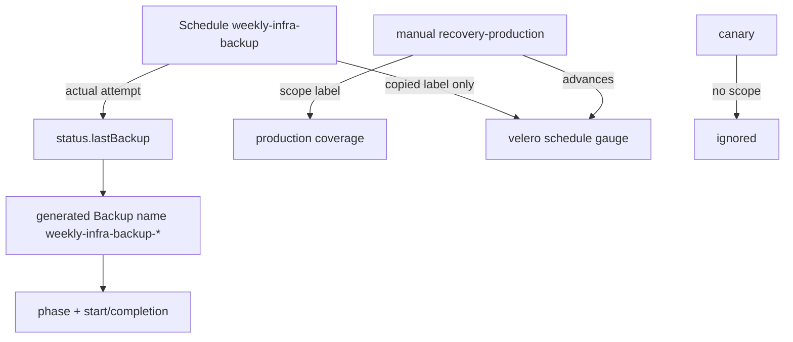

# Required production-backup monitoring (#139)

Status: deployed and initial live checks verified after #155 corrected the #154
startup OOM. Production coverage and actual weekly execution are separate signals.
This does not certify application recovery or a successful new scheduled backup.

## Verified failure mode

| Live signal (2026-10-20) | Value | Consequence |
|---|---|---|
| `velero_backup_last_successful_timestamp{schedule=""}` | `1792403166` (canary) | global stale alert absent |
| `velero_backup_last_successful_timestamp{schedule="weekly-infra-backup"}` | `1792404241` (manual) | schedule-labelled gauge also masked |
| `Schedule/weekly-infra-backup.status.lastBackup` | `2026-10-18T03:00:30Z` | actual last schedule attempt |
| `weekly-infra-backup-20261018030030` | `PartiallyFailed`, 4 errors | required run failed |
| `recovery-production-20261019` | `Completed`, 3681 items | useful manual coverage |
| `recovery-canary-20261019` | `Completed`, no `backup-scope` | drill only, never coverage |

Velero `--from-schedule` copies the schedule label onto a manual Backup. The
manual production Backup therefore advanced the schedule-labelled Velero gauge
without updating `Schedule.status.lastBackup`. Relabelling the global gauge is
not a fix.

Both scheduled and approved manual production backups carry
`backup-scope=infra-and-invenio`; only the generated name proves an actual
schedule execution.

## Deployment failure and budget rescue (2026-10-20)

The first sync OOMKilled the new KSM pod
`monitoring-kube-state-metrics-5565b6c4d9-4c6rv` (exit 137) about 8s after
startup at the 64Mi limit. Its logs showed the custom metric families registered
after CRD discovery, then the kill; there were no parse errors. The old pod
`monitoring-kube-state-metrics-67847459bc-fnnjp` stayed Ready, so existing KSM
collection remained available; that alone does not prove the Velero scrape
stayed continuous. ArgoCD reported `monitoring` Synced/Progressing until the
5-minute deploy-verify timeout (job `118440566890`); the other 16 applications
stayed healthy.

KSM v2.15 starts a cluster-wide CRD informer for custom resource state. The
optional `resourcePlural` field does not bypass that discovery: `FromConfig`
resolves every GVK through the CRD cache and overwrites the configured plural.
No collector rewrite or separate exporter is warranted.

## Source contract

Kube-state-metrics v2.15 (installed chart `kube-state-metrics-5.30.0`) custom
resource state metrics, no new exporter:

- `kube_customresource_velero_backup_completion_timestamp` from
  `status.completionTimestamp`, labelled `backup`, `schedule`, `scope`, `phase`.
- `kube_customresource_velero_backup_start_timestamp` from
  `status.startTimestamp`.
- `kube_customresource_velero_backup_creation_timestamp` from
  `metadata.creationTimestamp`; **never used for freshness** because storage
  resync recreates old Backup CRs with a new CR creation time.
- `kube_customresource_velero_schedule_status_last_backup_timestamp` from
  `Schedule.status.lastBackup`.

Production coverage freshness uses the newest `Completed` completion timestamp
with `scope="infra-and-invenio"`. A manual backup counts; a canary cannot. The
weekly signal uses only `Schedule.status.lastBackup` and generated
`weekly-infra-backup-<14 digits>` backups, so manual and canary success cannot
suppress it.

## Alert decisions

| Alert | Signal | Threshold / grace |
|---|---|---|
| `VeleroBackupStale` (warning) | newest production completion | >8 days, `for: 1h` |
| `VeleroBackupNeverSucceeded` (critical) | no Completed production completion **or** schedule `lastBackup=0` | `for: 10m` |
| `VeleroScheduledBackupOverdue` (warning) | schedule `lastBackup` age | >8 days, `for: 1h` |
| `VeleroScheduledBackupFailed` (critical) | generated run terminal phase within 5m of `lastBackup` | `for: 5m` |
| `VeleroScheduledBackupFailed` (critical) | no Completed generated run 4h after `lastBackup` | `for: 5m` |
| `VeleroBackupMetricsMissing` (critical) | schedule metric or Velero scrape absent | `for: 10m` |

The 4h missing-completion grace matches the configured Velero item-operation
budget; an ordinary `InProgress` backup must not page at 30m. Explicit
`PartiallyFailed`/`Failed`/`FailedValidation` terminations still page after the
5m anti-flap. `FailedValidation` normally lacks `startTimestamp`, so it falls
through the 4h missing-completion path rather than being guessed from CR
creation time.

A missing Completed production completion is itself critical: a healthy
schedule plus a fresh canary/global gauge cannot make coverage visible. KSM
normally omits a nil `status.lastBackup` gauge rather than emitting `0`; nil is
therefore caught by `VeleroBackupMetricsMissing`, while the numeric `0` sentinel
is caught by `VeleroBackupNeverSucceeded`.

## Wiring and verification

- Added `kube-state-metrics.customResourceState` plus `rbac.extraRules` for
  `velero.io` backups/schedules. The chart adds CRD list/watch RBAC when custom
  resource state is enabled. Offline render from the existing cached chart
  `/private/var/folders/nk/spb82z6d59g6fd9sl18zz_9r0000gn/T/tmp.RFpsnzWmbV/kube-prometheus-stack`
  confirmed kube-prometheus-stack 69.6.0 / KSM 5.30.0 (v2.15.0), the config
  mount/flag, `velero.io` RBAC, and CRD RBAC. No chart download or install was
  performed.
- KSM memory limit raised 64Mi -> 128Mi; the request stays 64Mi, so KSM remains
  Burstable and the extra limit reserves no node memory. This is a bounded
  startup candidate, not a measured peak: the OOM leaves no usable cAdvisor
  max-memory sample and the new collector never reached steady state. The
  monitoring quota has room (requests 2368Mi/6Gi, limits 4800Mi/24Gi). Initial
  live working set was 103Mi; this is not a long-term or peak measurement.
- Dashboard `00 InvenioRDM Overview` now shows production completion age;
  `02 Data & Backups` shows actual weekly generated runs by phase.
- `scripts/ci-validate-monitoring.sh` pins the collector config, RBAC, alert
  source terms, and dashboard source.
- `scripts/tests/test_monitoring_alerts.py` pins the KSM request/limit budget
  so the 64Mi OOM cannot silently return.
- `k8s/infra/monitoring/tests/backup-alerts.test.yaml` covers: fresh canary vs
  stale production, fresh manual + failed weekly run, completed weekly run,
  absent metrics, never-run, overdue, in-progress inside 4h then firing after
  4h, and old completion with recent CR creation/resync remaining stale.
- `python3 -m unittest scripts/tests/test_monitoring_alerts.py` and
  `bash scripts/ci-validate-monitoring.sh` pass (27 alerts, 4 dashboards).

Cleanup query proof: Prometheus `ALERTS{alertname="KubeQuotaFullyUsed",
namespace=~"recovery-.*"}` returned an empty vector after the three drill
namespaces were removed. Velero Backup/Restore/Repository records were preserved.

## Remaining gaps

- #155 merged `1ecb2a1`; Deploy Verify `39366564455` passed. Monitoring reached
  that exact values revision; KSM rollout completed with one Ready Pod and zero
  restarts. Logs registered all four custom metric families without parse errors.
- Live completion metrics matched the three retained backups: production manual
  `1792404241`, canary `1792403166`, failed weekly `1792293341`. Actual weekly
  attempt was `1792292430`; the canary has no production scope label.
- Missing-metric, missing-production, stale and overdue alerts were inactive;
  `VeleroScheduledBackupFailed` was pending its 5m hold, correctly retaining the
  failed weekly attempt despite fresh manual coverage. All Velero rules healthy.
  Drill quota alerts absent; production database healthy and public ping HTTP200.
- Long-term memory and notification delivery are not established by these checks.
- Weekly RPO is still 7 days plus the 1-day alert grace; this change makes gaps
  visible, it does not shorten RPO.
- A legitimate backup still running after 4h pages by design; tune only with
  evidence that the item-operation budget changed.
- Weekly correlation intentionally uses the generated
  `weekly-infra-backup-<14 digits>` name plus a 5-minute `startTimestamp` window
  around `Schedule.status.lastBackup`. Renaming the schedule or changing name
  generation requires updating the rule and tests together.
- Grafana panels and alerts remain blind if KSM itself is not scraped; existing
  `KubeStateMetricsDown` covers that dependency.
