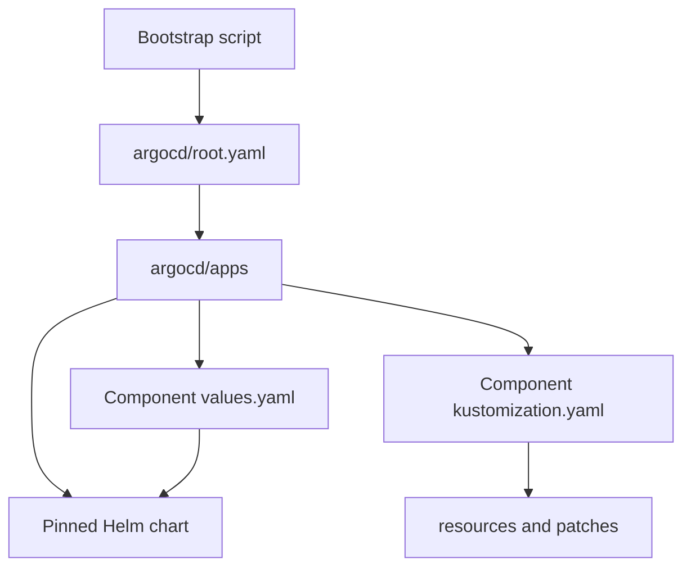

# Repository map

This is the canonical inventory of maintained deployment paths. Dated assessments
and historical plans describe past observations, not current source locations.

The root selects child Applications. Each child selects a pinned chart and its
values, a Kustomize directory, or both; values files are not Kubernetes resources.

## Deployment selectors and runtime sources

| Path | Consumer / role |
|---|---|
| `argocd/root.yaml` | Root `apps` Application; selects `argocd/apps` |
| `argocd/apps/*.yaml` | Application identities, destination, source versions/paths and ownership |
| `k8s/apps/invenio/kustomization.yaml` | `invenio-bootstrap`; application resource list and shared image component |
| `k8s/apps/invenio/image-pin/` | Single Git image digest component; ImageUpdater's Application override is applied after it |
| `k8s/apps/invenio/initialization/` | Manual initialization Job and render Kustomization; excluded from automated sync |
| `k8s/apps/invenio/resources/` | Web, workers, Beat, setup, HPA, PDB, PVCs, configuration, Secrets and routes |
| `k8s/dependencies/postgresql/` | `invenio-postgresql`; CNPG operator values and database custom resources |
| `k8s/dependencies/opensearch/` | `invenio-opensearch`; pinned single-node chart values and namespace/network resources |
| `k8s/dependencies/redis/` | `invenio-redis`; raw Deployment, Service, PVC and governance resources |
| `k8s/infra/argocd/` | `argocd-self`; upstream installation, local resources and referenced patches |
| `k8s/infra/argocd-image-updater/` | Image Updater installation, encrypted credentials and updater custom resource |
| `k8s/infra/cloudflared/` | `cloudflared`; runtime DaemonSet, Service, ServiceMonitor and encrypted credentials |
| `k8s/infra/{traefik,loki}/values.yaml` | Helm-only components; no ceremonial resource directories |
| `k8s/infra/alloy/` | Helm values plus namespace-scoped RBAC and PodMonitor |
| `k8s/infra/monitoring/` | Monitoring chart values; resources package dashboards, alerts, routing and network policies; `tests/` holds rule cases |
| `k8s/infra/minio/` | Helm values plus encrypted credentials, bucket initialization, routes and the authoritative S3 backup command/config with generated ConfigMap and suspended CronJob |
| `k8s/infra/velero/` | Helm values plus weekly Schedule, bounded data-mover configuration and metrics access |
| `k8s/infra/security/` | Network policies, quotas, limits and namespace admission policy resources |
| `k8s/infra/sealed-secrets/` | Pinned upstream controller installation |
| `external-lb/terraform/` | External Cloudflare tunnel/DNS provisioning, not Kubernetes workload manifests |
| `external-lb/scripts/` | Separate privileged provisioning helper; never routine repair sync |

Component roots contain only what is consumed: `values.yaml` for Helm,
`kustomization.yaml` for custom resources, `resources/` for objects and `patches/`
for referenced transformations. Existing ArgoCD patch subdirectories remain part
of the same component. Do not apply the whole `k8s/` tree recursively: values and
patches are not standalone resources.

CNPG and OpenSearch each use one `$values` Git source that also supplies their
Kustomize resources. There are no inline overrides or editable CI value mirrors.
The OpenSearch values preserve the effective Application configuration, not the
obsolete unused file's extra probes or lock-deletion init container.

## Other authoritative inputs

- `docker/ugm/`, `site/`, `templates/`, `static/`, `translations/`, `assets/` and
  `app_data/`: application image inputs; image changes need a build.
- `scripts/generate-sealed-secrets.sh`: outputs encrypted manifests to their
  component `resources/` directories; plaintext stays local and is never committed.
- `.github/workflows/validate-infra.yaml`: CI entrypoint.
- `scripts/manifest_sources.py`: discovers actual Application sources, release
  names, namespaces, chart versions and values references for CI rendering.
- `rendered/`: generated validation output, never desired state.
- `docs/current-state.md`: dated operational snapshot, current placement, backup
  schedules and experiment-readiness gates.
- `docs/architecture-guide.md`: controller, scheduling and data-flow concepts;
  `docs/operations.md`: day-to-day checks and recovery boundaries.

## Safe structural changes

Keep `Application` names, Helm release names, resource names, namespaces, PVCs,
Secret names/scope, chart versions and tracking ownership unchanged. Compare
rendered identities and complete objects before review; YAML lint alone is not
equivalence. A source-path change does not authorize a chart upgrade, migration,
bootstrap rerun or secret reseal. Before approved adoption, inspect the Argo diff
for deletions/recreations; rollback restores selectors and source paths together.

See [architecture](architecture-guide.md) for controller/data-flow concepts,
[operations](operations.md) for validation and recovery limits, and
[current state](current-state.md) for the dated live snapshot.
