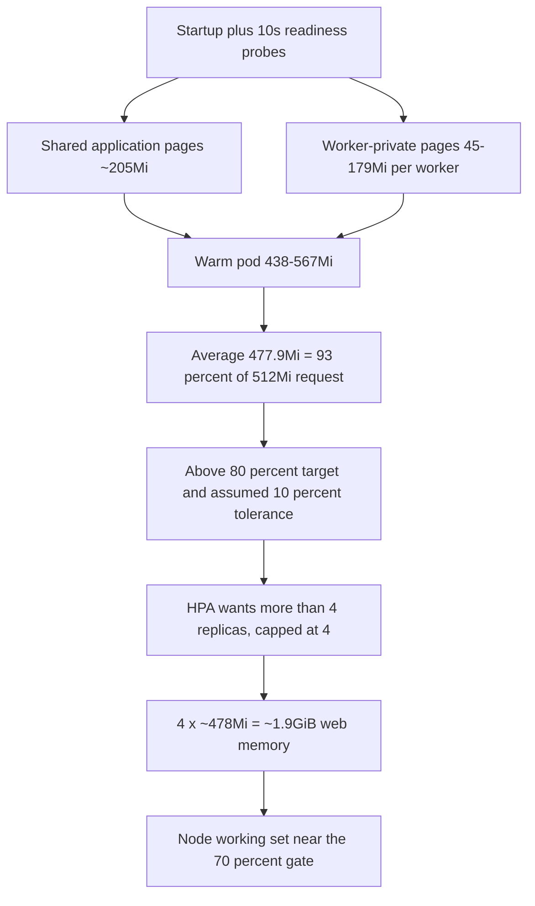

# Web idle memory and HPA amplification — findings

Observed: 2026-10-28 16:44–17:03 UTC. Namespace `invenio`, cluster `btd`.
Read-only: no manifest, HPA, probe, process-count, image, node or experiment
change. This document records evidence and decision options; it does not
authorize a rollout.

Revision note after lead review: option effects are expectations or estimates
under the observed idle conditions, the 10% HPA tolerance is an assumed
controller default, and probe attribution is aggregate consistency within the
window, not proof of zero traffic or absence of longer-term growth.

## Verdict

No unbounded leak or manifest defect is demonstrated within the observed
window. Warm Invenio web pods settled at 438–567MiB each (477.9MiB average)
after a 2–4 hour warm-up under the observed idle/probe workload. The HPA
memory target is 80% of a 512Mi request = 409.6MiB, so the observed warm set
was 93% of request. The HPA asks for more than four replicas and is capped at
four. Under this fixed process baseline and idle/probe workload, adding
replicas cannot reduce per-pod memory; real user load could change that
relationship and is outside the observation. The resulting four copies took
~1.9GiB of node memory and kept worker nodes near the experiment's 70% gate.



The diagram separates the two memory components from the control-loop
consequence: per-pod warm memory is above the HPA's target, so the HPA
amplifies it into four replicas, and the node gate sees the sum. The observed
window is consistent with a bounded plateau; it does not establish a growth
loop, but it cannot exclude longer-term or load-dependent growth outside the
observation.

## Live configuration and process model

- Deployment image `ghcr.io/vityasyyy/invenio-ugm@sha256:14de27fa…`, args
  `uwsgi --ini /opt/invenio/var/instance/uwsgi_ui.ini`.
- Runtime ini matches `docker/ugm/uwsgi_ui.ini`: `http` on 5000, `stats` on
  9000, `processes = 2`, `threads = 2`, `single-interpreter = true`.
- Requests 512Mi, limit 2Gi. Readiness and startup probe `/ping` every 10s;
  no liveness probe.
- Each pod: uWSGI master PID 1, request workers 141/143, and a fourth uWSGI
  process (145) consistent with the `http` option's router. Sampled workers
  report 2 cores each, both active, zero exceptions. `respawn_count=1` with
  `last_spawn` at pod start + ~15s: no later worker respawn. Container
  restarts 0.
- The router sent roughly 72–81% of requests to the busier worker; in the
  sampled workers the two cores split requests almost exactly evenly. This
  uneven worker distribution is not itself a defect.

## Memory accounting

PSS sums match cgroup `memory.current` within 2–7MiB. File cache is under
4.1MiB, so the footprint is anonymous shared application pages plus
worker-private dirty pages, not page cache. Summing RSS would double-count
the shared application image.

| Pod | cgroup MiB | anon MiB | file MiB | PSS sum MiB | master+router PSS MiB | worker private dirty MiB | requests (worker 1 / 2) |
|---|---:|---:|---:|---:|---:|---:|---:|
| r2hsf | 575.8 | 569.1 | 1.2 | 569 | 87 + 89 | 168 / 178 | 2 037 / 6 481 |
| 27jks | 444.4 | 435.1 | 4.1 | 438 | 74 + 76 | 45 / 171 | 2 089 / 6 191 |
| nhhgd | 437.4 | 423.1 | 3.0 | 432 | 79 + 76 | 47 / 157 | 2 323 / 6 043 |
| xc8nf | 480.2 | 468.0 | 0.9 | 475 | 80 + 77 | 70 / 179 | 1 623 / 6 895 |

Cgroup `memory.events` OOM and OOM-kill counters were 0 in the sampled pod.
The 7-day Prometheus window has no `OOMKilled` reason and no
`container_oom_events` for any web container.

## Traffic: probes, not users

Pod ages imply 8 274–8 487 readiness probes per pod at one per 10s. Aggregate
uWSGI request counts are 8 280–8 518, within 0.4%. Every worker's transmitted
bytes per request is 278–286B, consistent with a small `/ping` response, not
page content. This is aggregate consistency, not request attribution: the
counters and response sizes are consistent with probe traffic dominating these
pods within the observation window, but they cannot exclude a few heavier
requests that do not move the aggregates, or traffic to other pods or at other
times. "No real users" is not "no HTTP traffic".

## Growth behavior: bounded plateau within the observed windows

Current pods after warm-up (about 19 hours, 15-minute samples): net +4.4 to
+9.0MiB, slope −0.01 to +0.23MiB/h. Prior-image pods over 3.9 visible days:
net +7.0 to +20.6MiB, slope +0.07 to +0.13MiB/h. Within the observed windows,
both are consistent with a bounded plateau with small allocator steps; neither
demonstrates a linear leak, and neither rules out longer-term or
load-dependent growth.

| Pod group | Observed window | Net change after warm-up | Slope |
|---|---|---:|---:|
| 595558779c current (4 pods) | ~19h | +4.4 to +9.0MiB | −0.01 to +0.23MiB/h |
| 7b76b95786 prior image (3 pods) | ~3.9d | +7.0 to +20.6MiB | +0.07 to +0.13MiB/h |

The largest observed one-minute peak was 983MiB on 2026-10-25 during HPA and
rollout churn; current peaks are 438–567MiB. A 2Gi limit leaves substantial
headroom. The exact cause of the 45–179MiB per-worker private-page spread is
not established: request counts and bytes-per-request are nearly identical
across workers, so the aggregate evidence does not support a request-mix
explanation. Per-thread Python allocator retention is a hypothesis, not a
finding.

## HPA arithmetic

At 17:02 UTC: memory 93% (501 124 096B average = 477.9MiB) against 80% of
512Mi = 409.6MiB; CPU 2% (1m). Desired 4, current 4,
`ScalingLimited=True / TooManyReplicas`. CPU is not the driver. The
`KubeHpaMaxedOut` alert is the expected symptom, not a separate fault.

With the assumed default 10% HPA tolerance (the controller setting was not
inspected) and `ceil(current × usage / target)`:

| Effective per-pod memory | HPA behavior at 4 replicas | Request needed at 477.9MiB warm |
|---|---|---|
| >450.6MiB (>88%) | wants to scale up, capped at 4 | ≥543Mi (e.g. 576Mi) stops scale-up only |
| 368.6–450.6MiB (72–88%) | no action, stays at 4 | — |
| ≤307.2MiB (≤60%) | can scale 4→3 | ≥797Mi |
| ≤273.1MiB (≤53.3%) | can reach 2 over successive steps | ≥897Mi |

These are arithmetic projections from the observed 477.9MiB average, not
measured post-change outcomes. The tolerance is an assumed default, not a
verified cluster setting.

Raising the request therefore does not free RAM and does not reliably
downscale: it first stops scale-up, then needs ~797Mi (for 3 replicas) or
~897Mi (for 2) while raising the four-replica reservation to ~3.1–3.5GiB.
Removing the memory metric is expected to let CPU at 0–2% scale to the minimum
of 2; the resulting ~0.95GiB working-set and ~1GiB request-reservation savings
are estimates that require rollout measurement, not measured changes. That is
an HPA policy change, not a memory fix.

Replica history is consistent with these assumptions: 3 replicas from the
start of the retained window (2026-10-21) through 2026-10-24, 4 during
2026-10-25 churn, 2 after cool-downs, then 3 on 2026-10-27 13:53, a 1–2
replica flap at 17:03–17:28 during rollout, and 4 from 18:03 onward. The daily cAdvisor
average proxy rose from ~59.6% (old pods) to 91.8% on 2026-10-28. Node context
at sampling: worker-02 moved 69%→72% and worker-01 68%→65%; web accounts for
~1.0GiB on worker-02 and ~0.9GiB on worker-01. The gate is node working set
over allocatable, not the HPA percentage.

## What is not established

- An unbounded leak beyond the observed windows. The observed windows are
  consistent with a plateau; the current image has only ~1 day of history and
  Prometheus retains ~7 days, so longer-term or load-dependent growth is not
  excluded.
- That the 2026-10-26 image change (S3 extras: invenio-s3, s3fs, botocore,
  aiohttp; 14 added packages) raised the baseline. Pods on that image before
  2026-10-27 13:53 were cooler (~290–384MiB); there is no A/B.
- The exact per-worker allocator cause, or behavior under real user load.
- That the 10% HPA tolerance is the effective controller setting. It is assumed
  default and was not inspected; the replica history is consistent with it but
  does not prove it.
- That any external traffic is absent cluster-wide; only these pods' aggregate
  counters and response sizes were measured.
- That the 70% node gate and the web HPA memory percentage measure the same
  thing. They do not: the gate uses node working set over allocatable; the HPA
  uses pod working set over its request.

## Options (decision required; none implemented)

All effects below are expected values under the observed idle/probe
conditions; none was applied or measured. CPU-only and replica savings are
arithmetic estimates that require an approved rollout and measurement.

| Option | Expected effect under observed idle conditions | Cost / risk |
|---|---|---|
| Add node memory or a worker | Raises headroom; no app behavior change (not measured here) | IT provisioning cost; does not fix HPA arithmetic |
| Remove the memory metric from the web HPA | Expected CPU 0–2% → 2 replicas; ~0.95GiB working-set and ~1GiB request-reservation savings (estimate; measure in rollout) | Loses memory-pressure scaling; material availability/capacity decision |
| Lower web `maxReplicas` to 2 | Expected ~0.95GiB working-set saving (estimate; measure in rollout) | Loses scale-up capacity under real load |
| Reduce `processes` 2→1 | Removes one worker's 45–179MiB private set; shared ~205MiB remains, so a single-worker pod is estimated around 390–410MiB if the remaining worker warms high (estimate; measure in rollout) | Halves request concurrency; HPA likely still stays at 4 because of tolerance; needs latency/throughput pilot |
| Raise request and/or target | Arithmetic projection: ~576Mi stops scale-up; ~797Mi for 3 replicas; ~897Mi for 2 | Does not free RAM; reservation rises; tolerance/ceil make downscale unreliable |
| Add `max-requests` worker recycling | Expected to cap worker-private high-water mark (not tested) | Cold-worker latency; no evidence of unbounded growth; needs a load pilot |
| Change probe cadence | Expected fewer `/ping` requests (not tested) | Weakens readiness detection; not shown to change the plateau |

The highest-leverage lever under the observed idle conditions is the HPA
policy (~0.95GiB estimated), but it is also the most consequential behavior
change. The process-count change is not sufficient to stop HPA saturation and
halves concurrency. Raising requests is ineffective until ~797–897Mi and
increases reservations. Do not implement any of these on this evidence alone;
any effect must be confirmed by an approved rollout or pilot.

## Verification required before and after any deployment

Before: record HPA current/desired/conditions and the exact metric value;
per-pod cgroup/PSS/worker-private pages; request counts and bytes/request;
node working set on both workers; restarts and OOM counters; and at least one
24-hour warm window.

After: repeat the same for at least 24 hours including a rollout, verify the
HPA settles at the intended replica count, node headroom improves without
moving pressure to the other worker, probes stay successful, and no OOM or
restart appears. If process count or probes change, add a controlled
throughput/latency check before a formal batch. The estimates above are not
acceptance criteria; measure the actual post-change HPA metric, replica count,
per-pod memory and node working set. The lead owns the separate
experiment-instrument defects; this document does not change them.

## Evidence and reproducibility

Raw Prometheus responses are in
`/private/var/folders/nk/spb82z6d59g6fd9sl18zz_9r0000gn/T/opencode/web-memory-194/`:

- `working-set-14d-15m.json` — range response used for the plateau table:
  `container_memory_working_set_bytes{namespace="invenio",container="web",metrics_path="/metrics/cadvisor"}`,
  14-day request with a 900s step; retention clipped the earliest series to
  2026-10-21.
- `container_memory_working_set_bytes-current-pods-5m.json`,
  `container_memory_rss-current-pods-5m.json` — current-pod 5-minute series.
- `hpa-memory-utilization-proxy-7d-10m.json`,
  `hpa_replicas-7d-15m.json`, `hpa_desired-7d-15m.json` — HPA history.
- `web_restarts-7d-15m.json`, `web_requests-7d-15m.json`,
  `web_limits-7d-15m.json`, `lifetime_max_web.json`, `oom_events_7d.json`,
  `last_terminated_oom.json`, `pod_start_times.json` — restarts,
  requests/limits, peaks and OOM checks.
- `invenio-web-7b76b95786-hvdqn-max1m-7d-5m.json`,
  `invenio-web-7b76b95786-9gzmb-max1m-7d-5m.json`,
  `invenio-web-595558779c-k9wst-max1m-7d-5m.json` — one-minute spike checks.
- `port-forward.log`, `port-forward.pid` — localhost Prometheus access record.

One-shot recomputation of the plateau table, using the same first-sample+4h
convention and only the pods in that table:

```bash
EVIDENCE=/private/var/folders/nk/spb82z6d59g6fd9sl18zz_9r0000gn/T/opencode/web-memory-194
python3 - "$EVIDENCE/working-set-14d-15m.json" <<'PY'
import json, sys
KEEP = {
    "invenio-web-595558779c-27jks", "invenio-web-595558779c-nhhgd",
    "invenio-web-595558779c-r2hsf", "invenio-web-595558779c-xc8nf",
    "invenio-web-7b76b95786-9gzmb", "invenio-web-7b76b95786-hvdqn",
    "invenio-web-7b76b95786-s4cqd",
}
for s in sorted(json.load(open(sys.argv[1]))["data"]["result"],
                key=lambda x: x["metric"].get("pod", "")):
    pod = s["metric"].get("pod")
    if pod not in KEEP:
        continue
    vals = [(int(t), float(v) / 2**20) for t, v in s["values"]]
    if len(vals) < 40:
        continue
    cutoff = vals[0][0] + 4 * 3600
    post = [(t, v) for t, v in vals if t >= cutoff]
    if len(post) < 20:
        continue
    n = len(post)
    mt = sum(t for t, _ in post) / n
    mv = sum(v for _, v in post) / n
    slope = (sum((t - mt) * (v - mv) for t, v in post)
             / sum((t - mt) ** 2 for t, _ in post) * 3600)
    print(f"{pod}: net {post[-1][1] - post[0][1]:+.2f}MiB, slope {slope:+.3f}MiB/h")
PY
```

Expected net deltas: current pods +4.43/+7.82/+9.00/+7.97MiB; prior-image pods
+6.98/+14.74/+20.58MiB. Exact values depend on the 15-minute sample boundary.
The convention is a review aid, not an independent warm-up detector.

- Process data: `/proc/<pid>/status`, `/proc/<pid>/smaps_rollup`,
  `/sys/fs/cgroup/memory.{current,stat,events,peak}` read inside each pod.
- uWSGI: raw JSON from `127.0.0.1:9000` inside each pod; no payloads,
  environment, cmdlines or secrets read.
- The Prometheus port-forward on localhost:19091 was closed after the queries.
- No cluster mutation, load generation, package/image download, secret
  access, restart, HPA/probe change, batch restart or deployment occurred.
