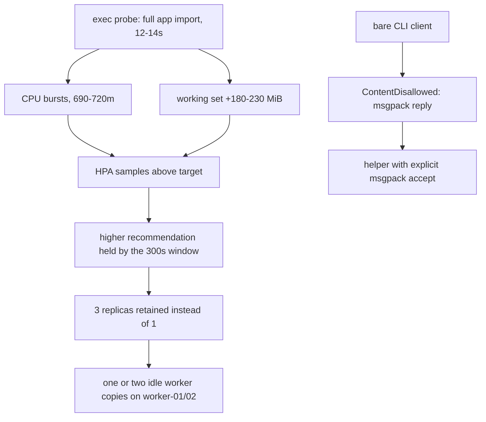

# Celery worker probe cost, msgpack replies and idle replica retention

Observed 2026-10-28 on `btd-rke2` with the `invenio` app idle. Read-only
inspection, Prometheus queries and two owner-approved live checks: the bare CLI
client failed, the corrected helper source answered once. The fix is prepared in
two un-deployed stages, described under "Delivered stages" below.
Related: #127 (probe cadence), #193 (idle CPU/memory investigation).

## Summary

The worker probes ran `celery -A invenio_app.celery inspect ping`, which builds
the whole Flask application in a new process on every execution. Kubelet's own
probe timing shows 12.2–13.8 s per run, 38–43 runs per hour per pod, and the
observed container CPU (511–515 CPU-seconds per hour) matches probe wall time
to within ~7 %. Each run also produces a working-set transient of roughly
180–230 MiB above the steady state.

`invenio-worker-hpa` reads those transients against 350 m CPU and 614 MiB memory
per pod. Its scale-down window keeps the highest recent recommendation, so the
deployment stays above its configured minimum of 1 replica.

Removing the import is necessary but not sufficient: a bare
`celery -b ... inspect ping` fails against this deployment. The worker's pidbox
replies are msgpack (Invenio's task serializer), while kombu's client mailbox
accepts json only, so the client raises `ContentDisallowed`. The fix is
therefore a small helper that keeps the same broker round-trip and accepts the
reply under an explicit, narrow policy. It ships in the image; the probe switch
is a separate change.



The probe import is the input this change removes; the replica count is an HPA
outcome that is expected to fall but is measured, not guaranteed.

## Evidence classes

- **Measured**: probe commands; kubelet `prober_probe_duration_seconds` and
  `prober_probe_total`; container CPU and working-set series; cgroup files and
  process list inside one worker pod; `describe hpa`; replica count series; node
  memory; the bare Celery CLI import cost; the live ping failure.
- **Reconstructed**: per-metric HPA recommendation numbers, computed from
  measured utilisation with the documented formula. The HPA does not export its
  sample history and the scrape series cannot show sub-minute flaps.
- **Hypothesised**: that every individual burst is a probe (cadence,
  destination and CPU budget match, but there is no per-process accounting at
  spike time); that no task work ran during the window (queue depth was not
  measured); that replicas will settle at a particular number.

## Evidence

Six-hour Prometheus window ending 2026-10-28T17:00Z, 15 s step.

| Signal | `5nxt7` | `td8bc` | `swg25` | scheduler |
|---|---:|---:|---:|---:|
| probe mean duration, readiness / liveness (s) | 12.29 / 12.23 | 13.10 / 13.81 | 12.71 / 12.84 | n/a |
| probe runs per hour, readiness / liveness | 31 / 12 | 28 / 10 | 31 / 12 | n/a |
| CPU mean (core) | 0.143 | 0.142 | 0.142 | 0.001 |
| CPU p99 / max (core) | 0.55 / 0.72 | 0.57 / 0.71 | 0.54 / 0.69 | 0 / 0 |
| working set median / p99 / max (MiB) | 425 / 651 / 668 | 362 / 572 / 644 | 398 / 600 / 615 | 215 / 216 / 218 |

- Probe wall time per hour is 528 s, 505 s and 548 s against 511–515
  CPU-seconds per hour: the probe process consumes about a core while it runs.
- Burst onsets recur at 120 s intervals (26–33 detected per hour per pod, each
  pod on its own phase), matching `readinessProbe.periodSeconds`. No failed
  readiness probes were recorded in the window.
- Live cgroup for `swg25`: `memory.current` 417 MiB, `memory.peak` 651 MiB,
  `anon` 374 MiB, `oom`/`oom_kill` 0, `nr_throttled` 45,772 of 436,720 CFS
  periods (142 s total). One parent (PSS 110 MiB) plus two children
  (143 / 127 MiB) matches `--concurrency=2`.
- 24 h first-hour vs last-hour working-set medians are flat (402→379,
  375→387, 407→405 MiB) on 2-day-old pods with 0 restarts: no growth or leak
  signature in the observed window.
- `invenio-worker-hpa` at 17:00Z: 3 current / 3 desired, CPU 0 %, memory 50 %,
  `AbleToScale=True ScaleDownStabilized`, `ScalingActive=True ValidMetricFound`.
  The replica series is 3 across 1,441 one-minute samples over 24 h; the
  seven-day five-minute view is also flat, but coarser and not used for finer
  claims.
- Placement matters for the node gate: `5nxt7` runs on worker-01, `td8bc` and
  `swg25` on worker-02, so two of the three retained replicas sit on the node
  that trips the 70 % baseline gate.

## Why the bare CLI client cannot be the fix

Pinned image source, read without loading the application:

| Fact | Location |
|---|---|
| Invenio sets `CELERY_TASK_SERIALIZER = "msgpack"` | `invenio_celery/config.py:24` |
| `flask_celeryext` maps it to Celery's `task_serializer` | `flask_celeryext/_mapping.py:82` |
| Client mailbox takes `accept=app.conf.accept_content` and `serializer=app.conf.task_serializer` | `celery/app/control.py:431-435` |
| Worker publishes pidbox replies with `mailbox.serializer` (= task serializer) | `kombu/pidbox.py:146-149` |
| Kombu's client mailbox default is `accept = ['json']` | `kombu/pidbox.py` (`Mailbox.accept`) |
| Empty reply set exits `EX_UNAVAILABLE` (69) | `celery/bin/control.py:186-192` |
| Reply limit defaults to the destination count, so one destination stops after one reply | `kombu/pidbox.py:345-347` |

The owner-approved live check on `invenio-worker-7459c5b6f7-swg25` failed
exactly there: exit 1 after 2.421 s, no pong, `kombu.exceptions.ContentDisallowed`
refusing `application/x-msgpack`
(`cluster-audit-20261028/celery-probe-live-verification.json`). The worker
answered; the client refused to decode the answer.

Invenio's configured accept list is `["json", "msgpack", "yaml"]`
(`invenio_celery/config.py:18`). The probe accepts msgpack and json only. Yaml
appears in the application policy but is never emitted for pidbox replies, so
accepting it in a probe would widen the deserialisation surface for no gain.
Pickle, yaml and wildcard acceptance are excluded and pinned by tests.

## Delivered stages

The change is split so that no rollout step can leave all worker probes
failing.

**Stage 1 — helper and image packaging (this change).**
`docker/ugm/worker_healthcheck.py` plus one Dockerfile `COPY` into
`${INVENIO_INSTANCE_PATH}`. The worker Deployment is untouched: probes keep
running the original `celery -A invenio_app.celery inspect ping` form, which
still works. Tests here cover the helper, the Dockerfile copy, and invariants of
the unchanged manifests.

**Stage 2 — probe switch (separate change).** The three probes run
`exec python3 /opt/invenio/var/instance/worker_healthcheck.py <timeout>` once
the helper-bearing image is running and verified. Cadence, `timeoutSeconds`,
`failureThreshold`, resources and the singleton scheduler are unchanged, and the
budgets stay 30/30/15 s. Its wiring regression lives in
`scripts/tests/test_worker_probe_wiring.py`.

The helper reads `INVENIO_CELERY_BROKER_URL` from the environment (it never
appears in argv), creates a Celery app with `accept_content = ["msgpack",
"json"]` before touching `app.control`, pings only `celery@<hostname>` with the
given timeout, and exits 0 only when that node returns the exact ping payload
`{"ok": "pong"}`.

The helper fails closed (exit 1) on: missing or empty broker variable, a
non-positive or non-finite timeout (checked before any client is created), no
reply, a reply from another node, a malformed replies container, an unexpected
payload such as `{"error": ...}` or a non-mapping value, a refused decode and a
timeout. It never prints the broker value or payload; failures print a short
reason only. It is not a process-exists check: a wedged consumer still fails.
Exit code 0 requires a broker round-trip from this pod's own node with its
documented pong.

The ping budget bounds the reply wait only. Kombu uses it as the reply-drain
timeout and stamps a message expiry, but connection establishment and producer
retries are not bounded by it: the kubelet `timeoutSeconds` is the only external
deadline for the whole exec, and for liveness and startup (25 s and 30 s) it is
not larger than the helper's budget, so a hung ping may be killed by the kubelet
before the helper exits 1. Both paths fail the probe; only the exit reason
differs.

Measured replacement import cost: 0.40 s wall / 0.50 s CPU, 29 MiB max RSS for
the Celery CLI modules. That is a module import, not the peak of the full helper
process, which was not measured.

## Runtime-library check (offline, in a pod)

One short check ran inside an existing worker pod with the pinned libraries and
`broker="memory://"`: no broker contact, no task publish, no application import,
no files written.

| Observed | Result |
|---|---|
| versions | celery 5.4.0, kombu 5.6.2, msgpack 1.1.2 |
| default client mailbox | `accept ('json',)` — the live failure |
| policy set before first `app.control` | `accept ['msgpack', 'json']` |
| policy set after first `app.control` | still `('json',)` — ordering matters |
| `prepare_accept_content(["msgpack","json"])` | `{application/json, application/x-msgpack}` |
| msgpack pong decoded under that policy | `{'ok': 'pong'}` |
| same pong under a json-only policy | `ContentDisallowed` (the live error) |
| memory-transport consumer round trip | did not deliver within 2 s; not used as evidence |

So the policy reaches the real mailbox consumer, and the real msgpack decoder
returns the documented pong. The committed unit tests still model the transport
with a fake `celery` module; this table is the runtime evidence behind it.

## Live helper check (one run)

One owner-approved check ran the helper source over stdin in
`invenio-worker-7459c5b6f7-swg25`: no file installed, no configuration changed,
one own-node control ping, reply timeout 15 s.

| Observed | Value |
|---|---|
| time | 2026-10-28T17:25:50.758Z |
| source commit / SHA-256 | `247b96b` / `094bb60eddab97109fbbe4a51e0a707dcb9056a397d15e28a4836b98dde1a1dd` |
| exit code | 0 |
| elapsed | 0.987 s |
| stdout / stderr | empty |

The staged helper is byte-identical to that source (same SHA-256), so the
verified artifact is the one being delivered. Evidence:
`cluster-audit-20261028/celery-corrected-helper-live-verification.json`.

This establishes that the helper is broker-compatible in that pod. It does not
establish that the helper is present in a built image, that kubelet exec probes
succeed with it, or that the resource and HPA behaviour improves in production.

## Rollout ordering (mandatory)

The probe command references a file that only exists in a rebuilt image, so the
change is staged as two deliveries. There is no acceptable window in which all
worker probes fail, and no fallback probe that silences a missing helper.

1. **Image first, probes unchanged.** Merge stage 1 (helper, Dockerfile `COPY`,
   tests and docs) without touching the Deployment. `build-image.yaml` triggers
   on `docker/ugm/**`; the resulting image is pushed and pinned. Workers roll to
   the new image while still using the original `-A invenio_app.celery` probes,
   which work, so nothing fails.
2. **Verify the helper is present.** `kubectl exec` one worker and run
   `test -f /opt/invenio/var/instance/worker_healthcheck.py`. No broker contact.
3. **Probe switch.** Merge stage 2; ArgoCD syncs the Deployment. Rollback is a
   manifest revert: on the new image it restores the original probes (which
   still work), and on an older image it is also a no-op for probe behaviour.

A fallback probe (`test -x helper || old probe`) would avoid the ordering
requirement but keeps two probe semantics and can silently mask a missing image,
so it is not used.

The helper source itself answered once over stdin (see "Live helper check"), but
the installed-file path and the kubelet exec path are still unverified. After
the image lands and with a new approval, run:

```
kubectl exec -n invenio <one-worker-pod> -c worker -- \
  python3 /opt/invenio/var/instance/worker_healthcheck.py 15
```

Expect exit 0 and no output. That is the in-image check; the earlier approvals
are used up.

## Expected replica outcome (reconstructed, not a guarantee)

The HPA recommendation for a utilisation target is
`ceil(currentReplicas × usage / (target × request))`. With the observed per-pod
working set of 362–425 MiB and the 768 MiB request:

| Current pods | Memory term | CPU term (0.142 core of 500 m) |
|---:|---:|---:|
| 3 | ceil(3 × 400/768 / 0.8) = 2 | ceil(3 × 0.284 / 0.7) = 2 |
| 2 | ceil(2 × 0.521 / 0.8) = 2 | ceil(2 × 0.284 / 0.7) = 1 |

The memory metric holds about 2 replicas while a warm worker keeps ~400 MiB
resident; reaching 1 would require per-pod memory below roughly 307 MiB. With
the probe cost removed the expected outcome is 3 → 2, releasing one worker's
~0.35–0.45 GiB. Scaling tolerance and `behavior` policies can hold the count
higher. Neither 1 replica nor a specific memory saving is promised.

## What this does not establish

- That probes are the only CPU or memory consumer; the budget closure is
  indirect (no event-level attribution, no queue-depth or completion data).
- That the helper works through an installed file and kubelet exec probes: one
  stdin run in one pod answered, but packaging, presence and probe scheduling
  are unverified.
- That replicas will settle at any particular number, or that sustained CPU and
  memory savings appear in production.
- The full helper process's working-set peak.

## Test coverage and its limits

`scripts/tests/test_worker_probe_contracts.py` (21 tests) models the transport
against a fake `celery` module: msgpack is refused when the client policy lacks
it (the observed failure) and accepted when the helper sets its policy; no
reply, a foreign node, a malformed replies container, an error payload, a
non-mapping payload, an exact-payload mismatch with extra fields, an unsafe
yaml reply, a decode refusal, a stalled ping, a missing or empty broker, and
invalid, zero, negative, NaN or infinite timeouts all exit 1 — and the broker
value and payloads are never printed. It also pins the Dockerfile copy, the
ConfigMap variable, liveness/readiness timeouts under their own periods and an
import-free scheduler probe. The probe invocation itself is pinned by
`scripts/tests/test_worker_probe_wiring.py`, which ships with stage 2.

These tests do not decode real msgpack and do not contact a broker; the
runtime-library check above covers the policy plumbing and decoder separately.

## Rollout measurement

Before: probe mean duration 12.2–13.8 s, CPU mean 0.142 core per pod,
working-set p99 572–651 MiB, 3 replicas.

After, from the same series: `prober_probe_duration_seconds` mean below ~2 s,
container CPU mean at or below ~0.05 core per pod with no 120 s burst above
~150 m, working-set p99 within ~50 MiB of its median, and the replica count
recorded rather than targeted. Also record the helper's working-set peak and,
during an experiment run, queue depth and task completion for the settled count.

## Open decisions

1. **Image/manifest sequencing.** The two-step staging above is the only
   no-fail-window path; the remaining choice is scheduling the two merges and
   who runs the post-image helper check.
2. **Replica floor.** If the experiment needs more than the memory-driven ~2,
   that belongs in `invenio-hpa.yaml` as an explicit capacity decision.
3. **Memory metric in the worker HPA.** Warm resident memory does not track
   queue depth; whether to keep the target is part of the same discussion.

## Rollback

`git revert` the change and let ArgoCD sync. The reverted manifest restores the
original `celery -A invenio_app.celery inspect ping` probes, which still work
against the current image (at the old cost), so rollback does not depend on the
new image. No state, queue, acknowledgement, routing or scheduler behaviour is
touched.
